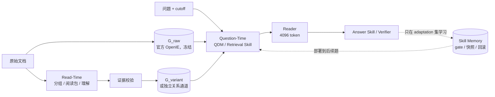

# RSI GraphRAG

> 研究问题：GraphRAG 能否在阅读时形成更好的跨文档理解，在问答时用技能补足检索/回答，并把验证过的经验沉淀为可回滚的 Skill Memory？
>
> 底座：官方 HippoRAG2（`index()` / `retrieve()` / PPR 未改）；LLM：HY4（`no_think`, T=0）；Embedding：NV-Embed-v2。


## 先看结论

**当前状态（2026-11-12）：** 四个数据集已完成探索。方法链路能跑通，但还没有得到“理解图稳定提升最终 QA”的证据。DetectiveQA 是当前主线，但在继续测图之前，要先修评测切分和 gold 标注。

| 问题 | 当前判断 | 最关键证据 | 置信度 |
|---|---|---|---|
| 图/理解层能提升检索吗？ | **局部能，跨数据集不稳定** | LoCoMo test R@5 `.864 → .885`；QASPER graph Any@5 `.692 < dense .740` | 中 |
| 检索提升能传到答案吗？ | **大多不能** | LoCoMo 8 个 R×Q 组合 F1 只在 `.472–.494` 之间波动 | 高 |
| 新关系为什么没用？ | **很少进入最终 top-k，进入后也可能挤掉原证据** | LoCoMo `99 → 5 → 1` 漏斗；QASPER 未覆盖子集 All@5 `.514 → .089` | 高 |
| Reader 是否限制上限？ | **是，但 DetectiveQA 不能只归因 Reader** | LoCoMo Oracle+P0 `.387` ≈ 正常 `.390`；DetectiveQA dense gold-all 只有 `.122` | 高 / 中 |
| DetectiveQA 能否测试长程理解？ | **结构合适，当前 split 不合适** | `recent .805/.805`；删掉 recent 后 `.439/.390`；30/41 题 cutoff 前已揭晓 | 高（41 题 pilot） |
| RSI Skill Memory 是否泛化？ | **机制跑通，效果为负** | LoCoMo eval 28 题命中：1 有益、1 有害、26 中性；E2 F1 `.508 < P7 .563` | 中（43 题） |

**下一步优先级：**
1. 构建 DetectiveQA anti-reveal 子集，并重审 gold。
2. 让每张表都带上 `recent`、`options_only_memory`、`oracle`、`q_dense` 这几条基线。
3. 先把关系层的人工 precision 提到 ≥75%，再做 R2–R5 图注入。
4. 图在 anti-reveal 子集上过了检索门槛，再启动 Question-Time / RSI 闭环。

## 用这三份文档定位问题

| 你想知道 | 入口 |
|---|---|
| 项目做到哪里、每个实验最后得到了什么、还缺什么 | [docs/PROJECT_STATUS.md](docs/PROJECT_STATUS.md) |
| 一个失败该归因为数据、检索、融合、Reader 还是技能 | [docs/ATTRIBUTION.md](docs/ATTRIBUTION.md) |
| 某个数据集的完整数字、case 和复现命令 | [experiments/README.md](experiments/README.md) |

其他资料：
- 方法细节：[docs/METHOD.md](docs/METHOD.md)
- 外部数字及口径差异：[docs/REFERENCE_NUMBERS.md](docs/REFERENCE_NUMBERS.md)
- 原始产物入口：[outputs/README.md](outputs/README.md)

## 实验时间线

| 顺序 | 数据集 | 想验证什么 | 结果 | 为什么转向下一阶段 | 详情 |
|---:|---|---|---|---|---|
| 1 | MuSiQue / Wiki | 能否先分组、再做跨文档理解 | 最好的分组也只让 313/1000 题 gold 同组；顺序切块已有 225 | Wiki 片段之间没有连续世界 | [01](experiments/01_musique_wiki/README.md) |
| 2 | LoCoMo | 分组、联合抽取、理解层、Question-Time、RSI | 检索小幅提升，QA 基本不动；Reader prompt 收益最大 | 池小、R@20 已 `.986`，1 题约等于 1pp | [02](experiments/02_locomo/README.md) |
| 3 | QASPER | triple / unit 能否改善论文内跨段证据检索 | M3 中性偏正；unit 覆盖 58%，等权 RRF 产生显著负迁移 | 段间关系偏结构化，单证据题比例高 | [03](experiments/03_qasper/README.md) |
| 4 | **DetectiveQA** | 长篇叙事中的远距离线索能否被理解层召回 | 图未过预注册门槛；recent 基线等于 oracle；关系 precision 66.7% | 当前主线，但要先修 split 和 gold | [04](experiments/04_detectiveqa/README.md) |

## 方法链路



| 阶段 | 关键约束 | 主要代码 |
|---|---|---|
| Read-Time | 不看问题；新关系必须有跨文档逐字证据；不改写 `G_raw` | `src/grouping/`、`src/comprehension/`、`src/graph/variants.py`、`src/detectiveqa/readtime.py` |
| Retrieval | dense、fact→PPR、RRF；DetectiveQA 删掉 cutoff 后的 passage、fact 和实体 | `src/retrieval/`、`src/detectiveqa/graph.py` |
| Reader / Answer | 统一 4096-token 预算；LoCoMo 后期固定 P7 | `src/retrieval/reader.py`、`src/prompt_optimization/reader_prompts.py`、`src/detectiveqa/reader.py` |
| RSI Memory | 反思 → sanitizer → 4 个 gate → dev 快照选择和回滚 | `outputs/question_evolution_conv30/qecode/` |

三段流程图和更详细的设计说明见 [docs/METHOD.md](docs/METHOD.md)。

## 读结果前的口径提醒

- 跨数据集的数值不要直接比较：检索单元、候选池、gold 粒度、Reader 指标都不一样。
- LoCoMo 用 SQuAD 风格 EM/F1，并复刻了官方 LoCoMo F1，都不是 Mem0 的 LLM-Judge J。
- DetectiveQA 当前只覆盖 6 部小说、41 道 human 题，1 题约 2.4pp；所有结论都按 pilot 级证据处理。
- QASPER 的 Evidence F1 是按 Reader 上下文计算的，比较检索时看 Any/All@k。
- 外部工作的数字只用于定位量级，见 [docs/REFERENCE_NUMBERS.md](docs/REFERENCE_NUMBERS.md)。

## 仓库地图

```text
README.md                         项目入口：结论、优先级、导航
docs/PROJECT_STATUS.md            进度台账：每个实验的结论、缺口、决策
docs/ATTRIBUTION.md               问题归因：失败类型、证据、诊断顺序
docs/METHOD.md                    方法与指标口径
docs/REFERENCE_NUMBERS.md         外部结果与口径差异
docs/plans/                       历史实验计划与执行 prompt
experiments/                      四个数据集的详细实验 README
outputs/                          报告、逐题 jsonl、summary、case
src/ scripts/ tests/              主代码、实验入口、单元测试
legacy/algernon_musique/          MuSiQue 早期代码和结果
```

以下内容没有入库，仍在服务器上：`.env`、`.venv`、`cache/`、`third_party/HippoRAG`、图工作目录、`*.parquet` / `*.pkl` / `*.sqlite`、原始数据集、逐次调用日志，以及可以重新生成的 `outputs/detectiveqa/chunks.jsonl`。

## 复现入口

```bash
# devcloud
cd /group/40150/licochen/Memory/RSI_GraphRAG
source .venv/bin/activate
python -m unittest discover -s tests -v
```

| 实验 | 入口 |
|---|---|
| LoCoMo 阶段 A | `bash scripts/run_all.sh` |
| LoCoMo 阶段 B | 按 `scripts/prompt_opt/00..19` 的编号顺序运行 |
| LoCoMo 阶段 C | 进入 `outputs/question_evolution_conv30` 目录，从 `python -m qecode.s0_split` 开始运行 |
| QASPER | `bash scripts/qasper/run_pipeline.sh`；完整步骤见 `outputs/qasper_readtime/README_PIPELINE.md` |
| DetectiveQA | [04_detectiveqa §8](experiments/04_detectiveqa/README.md#8-复现) |

运行前需要配置 `HY4_API_KEY` 等环境变量（见 `src/adapters/hy4_client.py`），并准备 NV-Embed-v2 本地权重和 `third_party/HippoRAG`。
