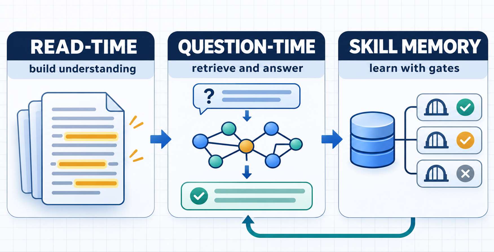
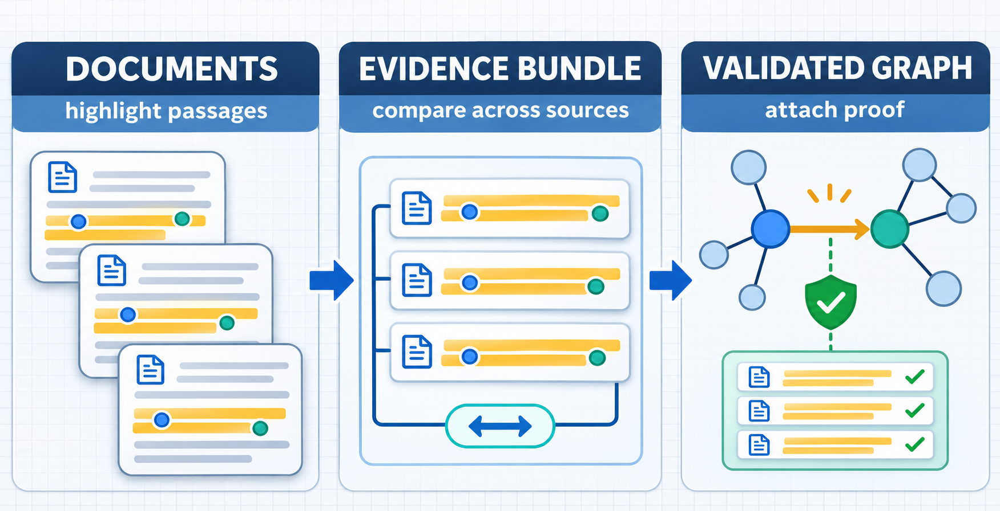
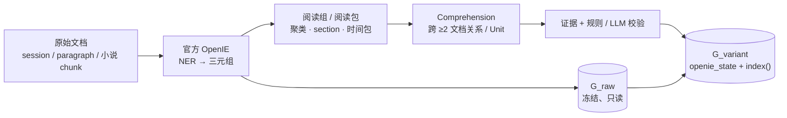
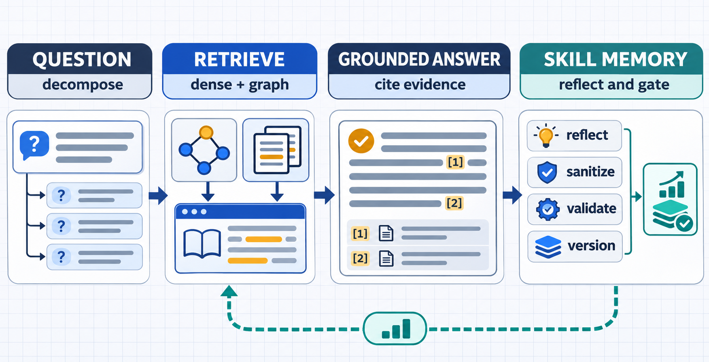
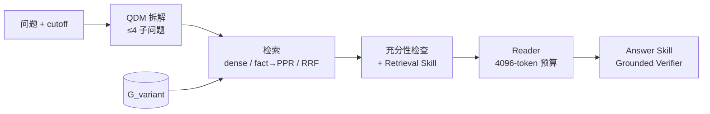
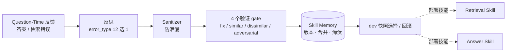

# RSI GraphRAG · 实验总览

> **Read-Time Comprehension Evolution × Question-Time Retrieval/Answer Skill × RSI Skill Memory**
> 底座：官方 HippoRAG2（`index()` / `retrieve()` / PPR 未改动），LLM = HY4（`no_think`, T=0），Embedding = NV-Embed-v2。

本仓库汇总我们从 2026-10-27 到 2026-11-12 在两台服务器上做的全部实验：代码、结果文件、报告、逐题 case。
**进度按时间倒序排列，最新的在最上面。**

## 0. 先看这里：这项工作在做什么？

**RSI GraphRAG** 研究的是：能不能让 GraphRAG 在“读文档时先形成更好的理解”，在“问题到来时再用技能补足检索和回答”，并把验证过的经验保存成可回滚的技能记忆。



上图只表达“研究闭环”的心智模型：底部回路表示经验持续沉淀，不表示 Question-Time 记忆会改写原始文档或冻结的 `G_raw`；精确的数据流和代码入口见 [§2 方法设计](#2-方法设计与完整-pipeline)。阅读 README 时可以沿着这条路径走：

| 先回答哪个问题？ | 先看哪里？ |
|---|---|
| 目前到底发现了什么？ | [§1 当前结论](#1-当前结论一分钟版) |
| 方法由哪些阶段组成？ | [§2 方法设计](#2-方法设计与完整-pipeline) · [docs/METHOD.md](docs/METHOD.md) |
| 结论由哪些数据集支撑？ | [§3 实验进度](#3-实验进度最新在上) · [experiments/](experiments/README.md) |
| 是方法问题还是数据集问题？ | [§5 问题诊断](#5-问题诊断数据集问题-vs-方法问题) |
| 怎么复现或核对原始结果？ | [§6 仓库结构](#6-仓库结构与代码地图) · [outputs/README.md](outputs/README.md) |
| 想看横向数字和外部参考 | [§4 数据集对比](#4-数据集横向对比) · [docs/REFERENCE_NUMBERS.md](docs/REFERENCE_NUMBERS.md) |
| 想看每个数据集的完整细节 | [experiments/](experiments/README.md) · [legacy/algernon_musique/](legacy/algernon_musique/README.md) |

---

## 1. 当前结论（一分钟版）

先记住三句话：**检索能变好，答案未必跟着变好；Reader 和数据集质量是硬上限；下一步要先修切分和标注，再继续加图。**

| 观察 | 目前结论 | 证据入口 |
|---|---|---|
| 检索层 | 局部可改善，但提升经常被 Reader 吃掉 | LoCoMo R@5 `.864 → .885`；QASPER 图低于 dense |
| 理解层 | 新关系很难进入 top-5 fact，覆盖不是唯一瓶颈 | conv-30 漏斗 `99 → 5 → 1` |
| 基准层 | DetectiveQA 的 locality、剧透和 gold 质量先于图结构需要修复 | `recent .805 = oracle`；30/41 题 cutoff 前已揭晓 |

1. **检索层可以被改善，答案层几乎不跟随。** LoCoMo test 上图变体把 R@5 从 .864 提到 .885，但 8 个组合的 F1 都在 .472–.494。
2. **新知识很少能进入检索链路。** conv-30 上有 99/105 题挂了触及 gold 的新关系，但只有 5 题进入 top-5 fact，最后只有 1 题（q16）变对。
3. **Reader 是硬上限。** LoCoMo Oracle+P0 的 F1 是 .387，和正常检索的 .390 一样。QASPER Oracle 的 Answer F1 也只有 .487。
4. **图检索的优势不是普适的。** LoCoMo 上图 > dense（R@5 .863 vs .791）。QASPER 上图 < dense（Any@5 .692 vs .740）。DetectiveQA 上两者打平，图的 MRR 还更低。
5. **当前主线 DetectiveQA 的结论是：先修数据集切分，再谈图。** 只取 cutoff 前 4096 token 的 `recent` 基线就有 .805，等于 oracle。`nonrecent` 跌到 .439/.390。LLM judge 判定 30/41 题在 cutoff 前已揭晓答案。
6. **下一步**（详见 [DetectiveQA §7](experiments/04_detectiveqa/README.md#7-下一步)）：
   - 构建 anti-reveal 子集并重审 gold。
   - 把 `recent` 和 `memory` 设为每张表的必报基线。
   - 关系层 precision 达到 ≥75% 后再注入图。
   - 之后才进入 Question-Time 闭环。

---

## 2. 方法设计与完整 pipeline

### 2.1 三条研究假设

| 模块 | 直觉 | 对应假设 |
|---|---|---|
| **Read-Time Comprehension** | 官方 OpenIE 在每个 chunk 内独立抽三元组，会漏掉只有跨文档才能得到的知识（状态变化、时序、指代统一、因果/动机）。阅读时做跨文档联合理解，图谱应更接近"理解后的知识"。 | H1–H4, H11 |
| **Question-Time Skill** | 问题到来时，QDM 负责拆解，Retrieval Skill 诊断缺失的关系链，Answer Skill 负责校验和修订，以补上静态图覆盖不到的查询形态。 | H5, H6 |
| **RSI Skill Memory** | 把 Question-Time 学到的经验写成可累积、可版本化、可淘汰的技能记忆，不改模型权重。 | H10 |

### 2.2 三段 pipeline：先看结构，再看实现

把完整系统拆成三个时间尺度后，阅读负担会小很多：**Read-Time 是离线建图，Question-Time 是每题在线推理，RSI Memory 是只在 adaptation 集上学习的反馈回路。**

#### ① Read-Time：把阅读理解写回图



这张图只突出“多段证据 → 对照阅读 → 校验 → 新关系”的解释路径；实际写入位置、证据字段和重建方式见下方 Mermaid 与 [docs/METHOD.md](docs/METHOD.md)。



对应代码：`src/grouping/`、`src/comprehension/`、`src/graph/variants.py`。这一阶段不看问题，目标是让图保存“理解后的知识”，并保留逐字证据。

#### ② Question-Time：从问题到可核验答案



这张图把在线问答和反馈回路放在同一张画布上；虚线回路只回到后续检索/回答策略，不回写原始语料或 `G_raw`。



对应代码：`src/retrieval/`、`src/question_skill/`、`src/detectiveqa/graph.py`。DetectiveQA 还会用 prefix-safe mask 去掉 cutoff 之后的 passage、fact 和实体。

#### ③ RSI Skill Memory：把错误变成可回滚经验



对应代码：`outputs/question_evolution_conv30/qecode/answer_evolve.py`、`outputs/question_evolution_conv30/qecode/retrieval_evolve.py`。这条回路只在 adaptation 集上学习，部署前通过 gate，避免把题目答案直接写进技能。

### 2.3 各模块要点（细节见 [docs/METHOD.md](docs/METHOD.md)）

| 模块 | 实现 | 关键代码 |
|---|---|---|
| G_raw | 官方 OpenIE + 同义边，构建后冻结 | `src/graph/hipporag_adapter.py`, `src/graph/runtime.py` |
| 图变体 | 复制 raw 工作目录，按内容哈希定位 chunk，把新三元组 append 到 `openie_state.json`，再重跑官方 `index()`。这一步没有新的 OpenIE 调用。 | `src/graph/variants.py` |
| 阅读分组 | random / temporal / entity_jaccard / entity_idf / embedding / hybrid / Louvain community；QASPER 用 section 组；DetectiveQA 用非 hub 实体的时间分布包 | `src/grouping/`, `src/qasper/grouping.py`, `src/detectiveqa/readtime.py` |
| Comprehension | 关系必须引用 ≥2 个文档并附逐字证据；`derivation ∈ {Composed, Inferred}`；DetectiveQA 额外区分 `claimed/suspected/contradicts` | `src/comprehension/`, `src/prompt_optimization/comprehension_prompts.py`, `src/qasper/readtime.py` |
| 检索 | dense（NV-Embed-v2）、官方 fact rerank + PPR、无 LLM rerank 的 top-5 fact、RRF（k=60）；DetectiveQA 的 prefix-safe PPR 会删掉未来 passage、fact 和实体 | `src/retrieval/`, `src/prompt_optimization/retrieval_diag.py`, `src/detectiveqa/graph.py` |
| Reader | 统一 prompt，4096-token 预算；LoCoMo 最终用 P7 | `src/retrieval/reader.py`, `src/prompt_optimization/reader_prompts.py`, `src/detectiveqa/reader.py` |
| Question-Time | QDM → Retrieval Skill → Answer Skill；ReAct + Grounded Verifier（R0–R5） | `src/question_skill/`, `outputs/question_evolution_conv30/qecode/` |
| RSI 闭环 | 反思 → Sanitizer → 4 gate → memory → dev 快照选择与回滚 | `outputs/question_evolution_conv30/qecode/answer_evolve.py`, `retrieval_evolve.py` |
| 工程 | 跨进程限流（HY4 ~1 QPS）、内容寻址缓存、原子写 | `src/adapters/ratelimit.py`, `src/embedding/nvembed.py` |

### 2.4 全程假设判定

| # | 假设 | 判定 | 关键证据 |
|---|---|---|---|
| H1 | 无监督分组能把相关文档放进同一组 | 弱成立 | LoCoMo entity_idf 共置 .431 vs 随机 .304；MuSiQue 完整 gold 同组只有 313/1000 |
| H2 | 联合抽取优于逐文档抽取 | 成立（检索） | LoCoMo test R@5 .875 vs .864 |
| H3 | 理解层能产生普通三元组表达不了的新知识 | 不成立 / 中性 | LoCoMo C6≈C5；QASPER M3 +1.1pp，CI 跨 0；DetectiveQA kept precision 66.7% |
| H4 | 理解图能提升检索和 QA | 检索成立，QA 不成立 | LoCoMo 证据覆盖 +0.7~1.8pp，EM/F1 ≤ ±0.5pp |
| H5 | Retrieval Skill 能补全关系链 | 检索弱成立，QA 不成立 | 触发率 92%（过度触发） |
| H6 | Read-Time 与 Question-Time 互补 | 不成立 | 检索最好的 R1Q2 在 QA 上不如 R1Q1 |
| H8 | 瓶颈在 Reader | 成立 | Oracle+P0 .387 ≈ 正常 .390；换成 P7 后 +13.1pp |
| H9 | 关系的价值取决于能否进入 top-5 fact | 成立（机制） | 漏斗 99 → 5 → 1 |
| H10 | 反思得到的技能能泛化 | 不成立 | 28 题命中：1 题有帮助，1 题有害，26 题中性 |
| H11 | Unit 比 triple 更适合作为理解的载体 | 整体否，覆盖子集是 | 覆盖子集 .567→.627；未覆盖子集 .514→.089 |

---

## 3. 实验进度（最新在上）

这一节按数据集倒序给出“规模 → 最好结果 → 一句话结论”；想看逐题 case、运行参数和阶段日志，可以直接进入对应实验 README。

| # | 时间 | 数据集 | 机器 | 状态 | 一句话结论 | 详情 |
|---|---|---|---|---|---|---|
| **4** | **11-11 → 11-12** | **DetectiveQA（英文小说）** | devcloud | Pilot + Round 2 完成；R2–R5 和 Question-Time 未跑 | 图没有过门槛；`recent` .805 = oracle；gold 不可靠 | [**04_detectiveqa**](experiments/04_detectiveqa/README.md) |
| 3 | 11-10 | QASPER（论文） | devcloud | 阶段 D 完成（100 篇 / 372 题） | 图 < dense；unit 覆盖 58%，等权 RRF 挤掉正确证据 | [03_qasper](experiments/03_qasper/README.md) |
| 2 | 11-05 → 11-10 | LoCoMo（长对话） | devcloud | 阶段 A/B/C 完成 | 检索提升但 QA 不变；Reader 是瓶颈；RSI 在 43 题上为负 | [02_locomo](experiments/02_locomo/README.md) |
| 1 | 10-27 → 11-03 | MuSiQue / Wiki | algernon | 分组审计、机制搜索、本地 Qwen pilot | Wiki 片段之间长不出跨文档理解；分组无法让 gold 同组 | [01_musique_wiki](experiments/01_musique_wiki/README.md) |

### 4 · DetectiveQA（当前主线）

| 规模 | gold | 每题 gold / 可见池 | 外部参考 |
|---|---|---|---|
| 62 部小说，600 道四选一（human 154 / AI 446），14,166 chunk | 有（clue 段落号）+ `answer_position` cutoff | gold chunk 中位数 4；可见 chunk 中位数 170；clue 跨度中位数 645 段 | ComoRAG (GPT-4o-mini) 68.2，HippoRAGv2+IRCoT 62.5 |

| 条件（41 道 human 题，seed0/seed1） | Acc | 条件 | R@10 / All@20 / MRR（q-only） |
|---|---|---|---|
| options_only_memory | .463 / .439 | q_dense | .418 / .220 / .544 |
| q_dense | .658 / .585 | q_graph_f5 | .425 / .244 / **.497**（McNemar p=.012） |
| q_graph | .683 / .658 | q_rrf(dense+graph) | .429 / .220 / .516 |
| **recent（cutoff 前 4096 token）** | **.805 / .805** | relation RRF | .312 / .195 / .352 |
| nonrecent_q_dense | .439 / .390 | | |
| oracle（gold chunk） | .805 / .707 | | |

- Read-time v3 漏斗：120 个包 → 1,435 个候选 → 601 条 kept。人工审计 kept precision 为 **66.7%**，低于 75% 的门槛。
- 结论：问题主要出在数据集，具体是 locality、标注和剧透；其次是关系层 precision 不够。→ [详情](experiments/04_detectiveqa/README.md)

### 3 · QASPER

| 规模 | gold | 每题 gold / 池 | 外部参考 |
|---|---|---|---|
| dev 281 篇 / 1,005 题；样本 100 篇 / 372 题（333 题有文本证据） | 有（多标注者 evidence 段落） | gold 均值 1.75，P90 3；每篇段落 P50 43 | LED-base Answer F1 33.6；人类 60.9 |

| 方法 | Any@5 | All@5 | Answer F1 |
|---|---|---|---|
| Dense | **.740** | **.593** | .464 |
| G_raw (M1) | .692 | .544 | .455 |
| +Comprehension triples (M3) | .707 | .556 | .454 |
| +Units RRF (M4) | .545 | .401 | .435 |
| Full paper / Oracle | — | — | .476 / .487 |

→ [详情](experiments/03_qasper/README.md)

### 2 · LoCoMo

| 规模 | gold | 每题 gold / 池 | 外部参考 |
|---|---|---|---|
| 10 段对话，272 session，1,986 QA | 有（turn 级 `dia_id`） | 证据 1.42 条/题；每段对话池 19–32 session | Mem0 J 66.9，Full-context J 72.9（GPT-4o-mini，口径不同） |

| 阶段 | 最好结果 | 结论 |
|---|---|---|
| A 全链路（1,986 题） | R@5 .864→.885，F1 .472–.494 | 检索提升，QA 不动 |
| B conv-30 prompt | P7 Reader：F1 .390→.521；最佳组合 .539 / 官方 F1 .569 | Reader 是瓶颈；Comprehension 的独立收益只有 1 题 |
| C RSI 闭环 | 进化后 answer F1 .508，低于固定 P7 的 .563 | 机制能跑通，但小样本上为负 |

→ [详情](experiments/02_locomo/README.md)

### 1 · MuSiQue / Wiki

| 规模 | gold | 每题 gold / 池 | 外部参考 |
|---|---|---|---|
| 1,000 题，11,656 passage | 有（supporting passages） | gold 均值 2.65（2–4 hop）；全局池 11,656 | HippoRAG2 R@5 74.7，NV-Embed-v2 69.7 |

- 实体–文档二部图：最大连通分量覆盖 98% 的 chunk。
- 零 API 分组：完整 gold 同组最多 313/1000，顺序切块已有 225。
- 机制搜索：被接受的大多是"补漏"，干净的跨段落关系只有 1 条。
- 结论：我们放弃了 index-time 分组，转向长篇连续文本。→ [详情](experiments/01_musique_wiki/README.md)

---

## 4. 数据集横向对比

横向表格用同一组维度比较四个数据集，帮助读者判断哪些差异来自方法，哪些差异来自基准本身。

| 维度 | MuSiQue | LoCoMo | QASPER | DetectiveQA |
|---|---|---|---|---|
| 文本形态 | 独立 Wiki 片段 | 两人长对话 | 单篇论文 | 长篇侦探小说 |
| 检索单元 | passage | session | paragraph | ~200 词 chunk |
| 每题候选池 | 11,656（全局） | 19–32 | P50 43 / P90 70 | 中位数 170（prefix 可见） |
| 每题 gold | 2.65 | 1.42 | 1.75（P90 3） | chunk 中位数 4 |
| 多证据占比 | 100%（2–4 hop） | 16.5% | 36.8% | 绝大多数 |
| gold 质量 | 高 | 高（8 个 dia_id 无法映射） | 多标注者，映射率 100% | **差**：16/41 不充分，30/41 cutoff 前已揭晓 |
| Full-context 能否装下 | 否 | 能（11k–22k token） | 能（均值 4.7k） | 否（prefix ~50k 词） |
| 检索饱和度 | 低 | R@20 ≈ .986 | Dense Any@5 .740 | Dense R@10 .418 |
| 适合验证"跨文档理解"吗 | ✗ 片段碎 | ✗ 池太小 | △ 段间关系弱 | ✓ 结构合适，但标注和切分需要修 |

外部方法的数字和口径差异见 [docs/REFERENCE_NUMBERS.md](docs/REFERENCE_NUMBERS.md)。

---

## 5. 问题诊断：数据集问题 vs 方法问题

先按“证据有没有到达 Reader、有没有被正确使用、是否被融合策略挤掉”定位失败，再看数据集是否把方法信号掩盖了。

| 失效模式 | 定义 | 出现在 | 归因 |
|---|---|---|---|
| ① 未到达 | gold 不在 Reader 上下文里 | 四个数据集都有；QASPER 42% 的题没有 unit 覆盖 | 检索 / 覆盖（方法） |
| ② 到达但没被用上 | 证据在上下文里，答案仍错 | LoCoMo 69 题证据完整，其中 53 题错；DetectiveQA oracle 仍错 6 题 | Reader（方法） |
| ③ 到达但被挤掉 | 新知识把正确证据挤出预算，或改变了 PPR 权重 | LoCoMo q24/q29/q54；QASPER 未覆盖子集 .514→.089；DetectiveQA relation RRF R@10 .418→.312 | 融合设计（方法） |
| ④ 表示层不可达 | 知识存在，但在 top-k 竞争中输给普通 fact | LoCoMo 99→5→1 | 表示 / 融合（方法） |
| ⑤ 策略过度应用 | 技能被错误触发 | Retrieval Skill 触发率 92%；answer skill 把具体日期改成 "Last Friday" | Question-Time（方法） |
| ⑥ 基准天花板 | 池太小或全文能装下，方法差异 ≤ 1 题 | LoCoMo（1 题 ≈ 1pp）、QASPER 单证据题 | **数据集** |
| ⑦ 局部性和剧透 | 决定性证据就在 cutoff 附近，或已被明说 | DetectiveQA：recent .805 = oracle；30/41 已揭晓 | **数据集** |
| ⑧ 标注不可靠 | gold 不充分、有歧义甚至错误 | DetectiveQA 16/41 不充分，23/41 有歧义 | **数据集** |
| ⑨ 参数记忆 | 不看原文也能答对 | DetectiveQA memory 基线 .463（随机 .25） | 数据集 / 模型 |
| ⑩ 语料结构不匹配 | 文档彼此独立，没有"连续世界" | MuSiQue 的大多数接受项是补漏 | **数据集与 claim 不匹配** |

**整体判断：** 每换一个数据集，都会暴露一类数据集问题（⑥⑦⑧⑩），掩盖方法本身的信号。也有三个方法问题稳定复现：Reader 上限（②）、融合挤占（③）、关系竞争不过普通 fact（④）。无论换到哪个数据集，这三个问题都需要先解决。

---

## 6. 仓库结构与代码地图

最后一节回答两个审核问题：每个结论对应哪段代码，以及复现实验需要哪些外部资源。

```text
RSI_GraphRAG/
├── README.md                   ← 本页
├── experiments/                ← 每个数据集一份详细 README（新→旧）
│   ├── 04_detectiveqa/  03_qasper/  02_locomo/  01_musique_wiki/
├── docs/
│   ├── METHOD.md               ← 方法细节（模块、prompt 约束、门控、指标口径）
│   ├── REFERENCE_NUMBERS.md    ← 外部工作的数字与口径
│   ├── RSI_GraphRAG_FULL_METHOD_AND_EXPERIMENTS.md   ← 148KB 主报告（LoCoMo + QASPER 全细节）
│   └── plans/                  ← 各阶段实验计划与执行 prompt
├── src/                        ← devcloud 主代码（与服务器同步）
├── scripts/                    ← 各实验入口脚本（detectiveqa/ qasper/ prompt_opt/ musique/ + LoCoMo 顶层）
├── tests/                      ← 单元测试（core / detectiveqa / round2）
├── data/                       ← LoCoMo 预处理结果与 split
├── outputs/                    ← 全部实验产物（报告、逐题 jsonl、summary）→ outputs/README.md
└── legacy/algernon_musique/    ← algernon 上 MuSiQue 阶段的代码与结果
```

**来源与同步**

| 本地目录 | 服务器来源 |
|---|---|
| `src/ scripts/ tests/ data/ outputs/ docs/` | devcloud `/group/40150/licochen/Memory/RSI_GraphRAG`（2026-11-12 拉取） |
| `legacy/algernon_musique/` | algernon `/data2-HDD-SATA-20T/nzq/TAG-experiment/{experiments, rsi_local_qwen_pilot}` |

**没有放进仓库的内容**（体积大或可以重新生成；都还在服务器上）：
- `.env`（密钥）
- `.venv`
- `cache/`（HY4/embedding sqlite 缓存）
- `third_party/HippoRAG`（官方 @ `d5c8329`）
- 各类 graph 工作目录
- `*.parquet` / `*.pkl` / `*.sqlite`
- 原始数据集 `data/raw`
- `outputs/logs/hy4_calls*.jsonl`（逐调用日志）
- `*.partial.jsonl`（断点续跑的中间文件）
- `outputs/detectiveqa/chunks.jsonl`（26MB，可由 `scripts/detectiveqa/prepare_data.py` 重新生成）
- algernon 的 `artifacts/openie`（48MB）

**复现入口**

```bash
# devcloud: cd /group/40150/licochen/Memory/RSI_GraphRAG && source .venv/bin/activate
bash scripts/run_all.sh                       # LoCoMo 阶段 A：baselines → grouping → read-time → question-time → joint
python scripts/prompt_opt/00_official_metrics.py   # LoCoMo 阶段 B：按 scripts/prompt_opt/00..19 编号顺序执行
(cd outputs/question_evolution_conv30 && python -m qecode.s0_split)  # LoCoMo 阶段 C：s0 → answer_evolve → retrieval_evolve → s3..s7
bash scripts/qasper/run_pipeline.sh            # QASPER 阶段 D（逐步命令见 outputs/qasper_readtime/README_PIPELINE.md）
python scripts/detectiveqa/prepare_data.py     # DetectiveQA：逐步命令见 experiments/04_detectiveqa/README.md#8-复现
python -m unittest discover -s tests -v
```

> 需要 `HY4_API_KEY` 等环境变量（见 `src/adapters/hy4_client.py`），以及 NV-Embed-v2 本地权重和 `third_party/HippoRAG`。
