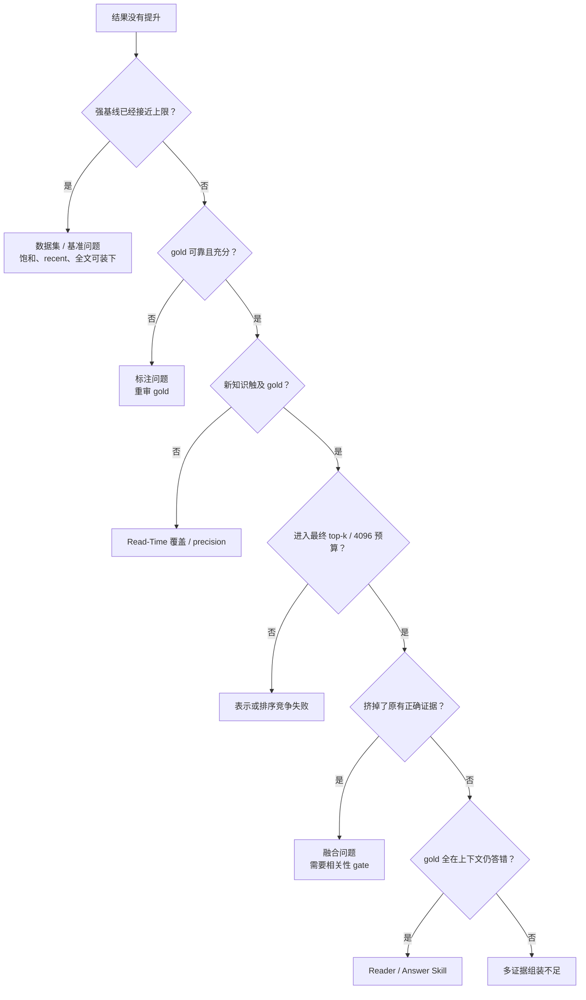

# 问题归因手册

> 用途：拿到一个“方法没提升”或“答案错了”的结果时，按这里的顺序排查，先找到第一个失效环节，再判断该改数据、检索、融合、Reader 还是技能。

## 诊断顺序

每个 case 都按这条链记录第一个失败点，不要同时把一个错误归到多个原因上。

## 失效类型表

| 代码 | 失效类型 | 判定标准 | 已观察到的位置 | 优先动作 |
|---|---|---|---|---|
| D1 | 基准饱和 / 捷径 | recent、全文或 dense 已接近 oracle；1 题造成大波动 | LoCoMo R@20 `.986`；DetectiveQA recent `.805` = oracle | 换子集或报告与强基线的差值 |
| D2 | gold 不可靠 | gold 不充分、有歧义、有错误，或 cutoff 前已经剧透 | DetectiveQA 16/41 不充分、23/41 有歧义、30/41 已揭晓 | 重审 gold；构建 anti-reveal |
| D3 | 理解层没有覆盖 / precision 不够 | 新关系或 unit 没有触及 gold，或人工审计是错的 | QASPER unit 覆盖 58%；DetectiveQA kept precision 66.7% | 扩大覆盖；提高 precision；做逐类型审计 |
| D4 | 排序竞争失败 | 新知识触及 gold，但没有进入最终 top-k | LoCoMo 99 → 5 → 1；MuSiQue 新边只能把排名拉到 13 | 调整表示、种子选择和 top-k 机制 |
| D5 | 融合挤占 | 新通道召回了相关文档，但把原有 gold 挤出预算 | QASPER uncovered `.514→.089`；DetectiveQA relation RRF R@10 `.418→.312` | 改等权 RRF 为置信度 / 覆盖 gate |
| D6 | Reader 上限 | gold 已完整在上下文中，仍然答错 | LoCoMo 69 题证据完整、53 题错；QASPER Oracle `.487` | 单独做 Reader，不把收益算给图 |
| D7 | 多证据组装不足 | 只拿到部分 gold，缺少完整证据链 | DetectiveQA dense gold-all `.122` | 报 gold-any 和 gold-all；改进多证据选择 |
| D8 | 技能过度应用 | 技能在不匹配的问题上触发或改坏答案 | Retrieval Skill 触发率约 92%；LoCoMo q38 | 增加触发 gate 和负迁移检查 |
| D9 | 指标口径误差 | 不同指标结论冲突，或字符串匹配误判 | LoCoMo 同一答案可得 0 / 1 / 0.667 | 主文写清口径，并做 judge 对照 |

## 跨数据集结论

| 层级 | 稳定出现的问题 | 结论 |
|---|---|---|
| 数据集 | LoCoMo 饱和；MuSiQue 没有连续世界；DetectiveQA 有 recency/reveal/gold 问题 | 每个新数据集都必须先做强基线和标注审计 |
| Read-Time | 新知识覆盖低、precision 不足，最有推理价值的关系类型最不准 | 先保证正确且跨块必要，再扩大数量 |
| Retrieval / Fusion | 新关系进不了 top-k，或进来后挤掉正确证据 | 需要 query-aware gate，不能直接等权 RRF |
| Reader | 检索收益不一定转成答案收益 | 每个实验都要同时报告检索、证据到达和 QA |
| RSI | 技能能写入和回滚，但触发不准，泛化弱 | 等底层检索方法稳定后再做闭环 |

## 新实验必报项

| 类别 | 必报内容 |
|---|---|
| 基线 | dense、raw graph、recent 或 full-context、oracle、参数记忆（适用时） |
| 检索 | Any/R@k、All@k、MRR、gold-any、gold-all |
| 机制 | 新知识触及 gold 的题数、进入 top-k 的题数、挤掉正确证据的题数 |
| QA | 主指标、按题型 / cutoff 分桶、两个 seed 或重复运行 |
| 统计 | 配对差值、按文档聚类的 CI、p 值、1 题对应的百分点 |
| Case | 正例、反例、gold 问题；每个 case 只标第一个失败点 |
