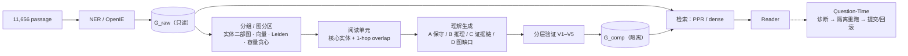

# 01 · MuSiQue / Wiki（多跳问答）— 最早阶段

> **时间**：2026-10-27 → 11-03 · **机器**：algernon（4×RTX 3090）· **LLM**：gpt-5.6-luna（API）/ Qwen3.5-9B（本地）· **Embedding**：NV-Embed-v2
>
> **一句话结论**：这个阶段在研究"阅读时怎么把相关文档聚到一起、再做跨文档理解"。结果表明，MuSiQue 的 Wiki 片段彼此独立，实体重叠形成覆盖 98% chunk 的巨型连通分量。任何无监督分组都最多只能让 31% 的题目 gold 同组（顺序切块就有 23%）。让 LLM "理解"得到的大多是 OpenIE 漏掉的原句补漏，干净的跨段落新关系只有 1 条，而且不改变召回。**问题主要在数据集和我们的 claim 不匹配**，所以转向了长篇连续文本（LoCoMo → QASPER → DetectiveQA）。

| 子实验（新 → 旧） | 日期 | 问题 | 结论 |
|---|---|---|---|
| [HippoRAG2 MuSiQue 索引准备](#36-11-11devcloud-上的-hipporag2-准备) | 11-11 | 在 devcloud 上用官方 HippoRAG2 重建基线 | 只完成数据审计和切分，未建索引 |
| [零 API 分组 benchmark](#31-零-api-分组-benchmark11-03) | 11-03 | 不调模型，哪种分组能让 gold 同组？ | 最好 313/1000，只比顺序切块多 88 题；**不进入联合抽取** |
| [实体–文档二部图审计](#32-实体文档二部图审计11-03) | 11-03 | 能否在抽三元组之前先用 NER 分组？ | 巨型分量占 97.99%，结构上不可行 |
| [v5 Read-Time 机制搜索](#33-v5-read-time-机制搜索11-01--11-02) | 11-01 → 11-02 | 哪种生成 + 验证机制能产生真正的跨段落理解？ | 证据链 C + 分层验证 V1–V5 最稳；但召回不变 |
| [v4 RSI GraphRAG pipeline](#34-v4-rsi-graphrag-pipeline10-29--10-30) | 10-29 → 10-30 | Luna 全量 G_raw + 关系图分区 + 两套阅读协议 | 冒烟完成；全量阅读和 Question-Time 未跑 |
| [本地 Qwen pilot](#35-本地-qwen-read-time-pilot10-27--10-28) | 10-27 → 10-28 | 本地 9B 模型能否承担 Read-Time？ | 16 个窗口全部返回空 patch；baseline = evolved |

**目录**：[1 数据集](#1-数据集) · [2 方法](#2-实验方法这一阶段的框架) · [3 各子实验结果](#3-各子实验结果新--旧) · [4 Case](#4-case-分析) · [5 已完成 / 未完成](#5-已完成--未完成) · [6 归因](#6-问题归因数据集还是方法) · [7 文件索引](#7-文件索引)

---

## 1. 数据集

### 1.1 规模（HippoRAG2 发布版的 MuSiQue 子集，`outputs/musique/data_audit.json`）

| 指标 | 值 |
|---|---|
| 问题 | **1,000**（全部可答） |
| 语料 | **11,656 passage**（9,838 个 Wikipedia title，647 个 title 对应多个 chunk），全库 1,348,035 token |
| **金标准** | **有**：每题的 supporting passages（`gold_pids`）+ 分跳子问题和中间答案 |
| **每题 gold** | 平均 **2.648** 个（2–4 hop）；977/1000 题至少有一对跨 title 的 gold |
| gold 在语料中的跨度 | 下标跨度中位数 1,424；跨度 ≤15 的有 378 题（所以顺序切块能碰巧命中一部分） |
| 候选池 | 全局 11,656（不是每题独立的小池） |
| 切分（devcloud，11-11） | practice 399 / dev 100 / eval 501 |
| eval hop 类型 | 2hop 259 · 3hop1 122 · 3hop2 37 · 4hop1 54 · 4hop2 13 · 4hop3 16 |

### 1.2 一道题长什么样

```json
{"qid": "2hop__13548_13529",
 "question": "When was the person who Messi's goals in Copa del Rey compared to get signed by Barcelona?",
 "answers": ["June 1982"], "gold_pids": [1, 2],
 "hops": [{"q": "To whom was Messi's goal in the first leg of the Copa del Rey compared?", "a": "Diego Maradona", "pid": 1},
          {"q": "When was #1 signed by Barcelona?", "a": "June 1982", "pid": 2}]}
```

每一跳的答案都在单个 passage 里明写。"多跳"靠的是问题把两段串起来，**不是文档之间本身有叙事关系**。这是后面所有负结果的根源。

### 1.3 别的工作做到多高

| 方法 | MuSiQue passage R@5 |
|---|---|
| HippoRAG2（NV-Embed-v2 + Llama-3.3-70B） | **74.7** |
| CogitoRAG（我们此前的工作） | 70.30 |
| NV-Embed-v2 dense | 69.7 |

更多数字见 [docs/REFERENCE_NUMBERS.md](../../docs/REFERENCE_NUMBERS.md)。本阶段没有在全库上跑出可以和这些数字直接比较的结果：本地 pilot 用的是 1,816 篇的封闭池，v5 用的是字符串种子 PPR。

---

## 2. 实验方法（这一阶段的框架）

### 2.1 最初的设想：Index-Time 分组 → 联合理解



- **G_raw 只读**：所有理解产物写入隔离的 G_comp，接受后可以停用或恢复。
- **gold 只在分组冻结后做事后计数**，不用来选阈值。
- 阅读单元的选取不读题目和 gold。

### 2.2 "理解"怎么做（v4 / v5）

| 生成方法 | 做法 | 观察 |
|---|---|---|
| A 保守 | 只收原文直接支持、三元组没写的句子 | 几乎只有补漏 |
| B 推理 | 允许把多条证据合成一条新关系 | 条数最多，重复和引文错配也多 |
| **C 证据链** | 每条候选写算子（`EXPLICIT_GAP` / `TEMPORAL_COMPARE` 等）+ 逐字引文 + passage id | **保留**；引文和 id 最准 |
| D 图缺口 | 先列缺口再填 | 会写错 passage id，弃用 |
| C2 先跨事实 | C 的顺序调换 | 负结果，丢了有用的补漏 |
| 结构引导（v5.3） | 程序找"无直接边但有共同邻居"的缺口，允许 NO_OP | 更常正确地说"没有新关系" |

**分层验证器 V1–V5**（不看生成器的自我分类）：

| 层 | 检查 |
|---|---|
| V1 | 引文必须是指定原文里的连续片段，否则 `EVIDENCE_MISMATCH` |
| V2 | 专名必须出现在引文所在句，或由篇名 / 句首代词接上 |
| V3 | 日期先后用代码比较；"before" 不能从 "and" 推出；接任关系必须有 succeeded / replaced 等明确说法 |
| V4 | 新颖性对照**该原文的全部 OpenIE 三元组**，而不只是单元切片 |
| V5 | 句子支持并且有未被覆盖的内容词才 ACCEPT；v5.1 再加语义蕴含检查，把改写标成 `REDUNDANT`，把区间端点比较标成 `TRIVIAL_DERIVATION` |

14 条历史候选上，V1–V5 与人工"该不该入库"的判断对齐 13 条。v5.1 语义蕴含在未见集上的标签正确率从 12/14 提到 13/14。

---

## 3. 各子实验结果（新 → 旧）

### 3.1 零 API 分组 benchmark（11-03）

不调用任何远程 LLM 或 Embedding API，只用现成的 NER 缓存和 chunk 向量。参数网格先冻结，再读 gold。

| 方法（全库阅读 1.0×） | 完整 gold 同组 / 1000 | 部分覆盖 | 最佳组中非 gold 比例 |
|---|---|---|---|
| 随机，每组 16 | 3 | .407 | .937 |
| 顺序切块，每组 8 / 16 | 137 / **225** | .535 / .614 | .831 / .901 |
| 向量，上限 8 / 16 | 165 / 209 | .543 / .586 | .827 / .907 |
| 实体 IDF，上限 8 | 226 | .575 | .802 |
| **向量 + 实体融合，上限 8 / 16** | 262 / **313** | .603 / .644 | .813 / .899 |
| 融合 + 1.5× 复制 | 354 | .683 | .855 |
| Jaccard ≥ 0.20 | 32 | .434 | .173 |
| （参考）IDF top-16，阅读 15.5× | 544 | — | — |

- Leiden、Louvain、Infomap、Label Propagation、KMeans 都会留下数百到上千个 chunk 的社区。真正能把组切到抽取窗口大小的是按边权的容量贪心。
- 无监督规则在读 gold 之前选中的是"向量 KNN、上限 16"，只有 209，**低于顺序切块的 225**。
- 多读 50% 原文只比最好的互斥分组多 41 题。
- **决定：不进入 Joint Triple Extraction，停止 Index-Time 分组路线。**

### 3.2 实体–文档二部图审计（11-03）

问题：能否在抽三元组之前，先用 NER 建实体–文档二部图，把跨文档证据收成小组？对比了 HippoRAG2 的 gpt-4o-mini OpenIE 和我们的 Luna G_raw。

| 观察 | 数字 |
|---|---|
| 最大连通分量 | gpt-4o-mini B1：11,422 chunk（**97.99%**）；Luna：11,365 |
| 巨型分量由谁造成 | `United States`、`American`、国家名、年份；但去掉 DF>2% 的 8 个实体后仍有 11,334 |
| 最严过滤（去掉 DF>10） | 最大分量仍占 **77.45%**，孤立 chunk 17.83%，没有出现中等簇 |
| Jaccard ≥ 0.20 硬组 | 最大 20 chunk，但只覆盖 15.5% 的 chunk；全部 gold 同组只有 **32/1000** |
| top-k 邻居 | top-2 要把全库再读约 3.2 遍，top-16 约 15 遍 |
| 稀有实体桥 | 约一半的题，gold chunk 之间没有 DF ≤ 50 的共享实体 |

结论：在这个语料上，共享实体首先是国家、年份、头衔、出版社和同形字符串。用实体重叠先分组再抽三元组，**结构上不可行**。

### 3.3 v5 Read-Time 机制搜索（11-01 → 11-02）

在冻结的阅读单元上比较生成方法 A/B/C/D/C2，用同一套分层验证器。

| 轮次 | 做了什么 | 结果 |
|---|---|---|
| v5.0 | A–D + C2，23 次 Luna 调用 | C 在大 / 中 / 小三个对照单元上接受 8 条：**7 条补漏，1 条跨段落（Tristan 早于 Ludwig）**；新单元上接受的 9 条全是补漏 |
| v5.1 | 加语义蕴含；不提高输出上限，只改输出结构 | 挡住了改写型误接受；短 schema 能在 overlap 单元上写完 |
| v5.2 | 10 个新单元 + PPR 审计 + 12 条冻结诊断查询 | 11 条理解：4 条补漏、7 条语义抽象、**0 条跨文档组合**；100 道 dev 题 R0 = R3（R@5 .401） |
| v5.3 | 结构引导（程序找缺口）vs 证据链 | 结构引导 4 条 ADD / 3 条保留，跨 passage 0；诊断集 R@1 .556 / R@5 .889，**四组完全相同** |

**v5.2 的关键机制发现**：

- 节点**确实进了图**：38 个实体槽全部对齐 G_raw，用它们做种子时 PPR 质量都大于 0。
- 但新节点没有形成通向远处 passage 的新路，质量停在新节点上。
- 受控工程探针：给 gold passage 接一条正确桥，名次从 4310 升到 13；接一条随机边，随机 passage 也升到 13。**一条无权新边只能拉进前 20，拉不进前 5。**
- 新理解的源文和 100 道 dev 题的 gold 交集为 0，所以 dev 召回不可能变。
- 把理解文本的词面分加回源文（R2），反而让 R@1 从 .163 降到 .093。

### 3.4 v4 RSI GraphRAG pipeline（10-29 → 10-30）

| 模块 | 实现 |
|---|---|
| `corpus_manager` | 冻结 passage id，写出不含答案的语料 |
| `hipporag_adapter` | 用官方 NER / triple prompt 生成不可变的 G_raw |
| `graph_analyzer` / `graph_partitioner` | 连通分量 + Leiden，超预算社区递归切分 + hop overlap |
| `comprehension_evolver` / `graph_patch_manager` | 只写 G_comp；证据 span 必须是原文子串 |
| `rag_verifier` | 在隔离快照上重跑 `rag()`，再决定提交或回滚 |

| 结果 | 数字 |
|---|---|
| Luna G_raw | 覆盖 11,622 篇（34 篇被内容过滤）；**84,654 实体 / 136,732 三元组**；最大分量占实体 95.0% |
| Leiden | 最大分量划出 106 个社区，其中 75 个超过 16,000 token；不设种子时两次分别得到 106 和 115 个 |
| 协议冒烟（3 个簇，53 次调用） | Protocol A（保守）稳，但多是补漏；Protocol B（合成）在小簇上得到了 Tristan/Ludwig，在大簇上 3 条全被验证器拒绝 |
| 机制图检索 | 只覆盖 1 道 update 题，R0 / R1 的 EM 都是 1；held-out 无法评测 |

未完成：全量 Luna OpenIE + synonymy、全量 R0–R3、600 题 adaptation 的 Question-Time、400 题 held-out。

### 3.5 本地 Qwen Read-Time pilot（10-27 → 10-28）

- **部署**：vLLM 0.21 因为驱动不匹配跑不起来；改用 transformers 服务 Qwen3.5-9B（约 12 token/s）。Qwen3.8-27B-FP8 已下载，但单张 3090 放不下。
- **能力（24 题）**：抽取 JSON 有效率 .875；给定 gold 证据时 EM .583 / F1 .704；只给干扰段落时弃答率 1.0。
- **Read-Time（8 题 / 160 篇 / 1,816 篇封闭池）**：传统建图得到 1,456 条三元组；16 个窗口 JSON 都有效，但 **patch 全部为 0**。模型自己选择不改图，不是门控拦掉。

| | R@1 | R@3 | R@5 | EM | F1 |
|---|---|---|---|---|---|
| Baseline | .375 | .625 | .771 | .375 | .552 |
| Evolved | .375 | .625 | .771 | .375 | .552 |

- 8 题里有 5 题 R@5 = 1，但 EM 只有 3 题。失败主要是答案太长、丢单位、证据到了仍答 unknown。这引出了后来"Question-Time 先做 Answer Skill"的判断（接口草案见 `rsi_local_qwen_pilot/reports/QUESTION_TIME_INTERFACE.md`）。

### 3.6 11-11：devcloud 上的 HippoRAG2 准备

转到 DetectiveQA 之前，曾在 devcloud 上用官方 HippoRAG2 为 MuSiQue 建标准基线。完成了数据审计和 practice/dev/eval 切分（`outputs/musique/`，代码 `src/musique/`、`scripts/musique/`）。eval 中有 317/501 题和 practice 共享至少一个 gold passage。索引没有建，因为主线转向了 DetectiveQA。

---

## 4. Case 分析

| 类型 | Case | 说明 |
|---|---|---|
| ✅ **唯一干净的跨段落新关系** | Tristan von Lahnstein "first appeared on 23 October 2009"；Ludwig "appeared from 22 December 2009" → Tristan 早于 Ludwig | 两个日期三元组都在，先后关系不在。但诊断查询 "Which character appeared earlier" 在 R0 上两篇已经是第 1、2，节点没改变名次 |
| ✅ 显式补漏 | Andrea Kremer："the first all-women booth to call any major men's team sport" | OpenIE 有共同解说和平台，漏了"首个全女性解说组"。旧验证器把单元截到 12,000 字符，看不到原句，误拒 |
| ✅ 显式补漏 | Morley "took a ten-week break ... to appear in the feature film, Blinder" | A/B/C/D 四种方法都独立写出 |
| ❌ 假时序 | Azawad："took control of by April **and** declared the secession" → 候选写成 "before" | 旧验证器接受，V3 拒绝 |
| ❌ 实体绑定失败 | Gemma "moves to Erinsborough to live with her aunt" → 候选写成 Madge Bishop + 动机 | 句中没有 Madge，"following" 不支持 motivated；V2 拒绝 |
| ❌ 幻觉 id | D 方法把 Kremer 的 passage id 写成不存在的 `chunk-c30c...` | V1 拦下（证据错位，不是内容为假） |
| ❌ 低价值推导 | Law of the Plainsman "aired from October 1, 1959, until May 5, 1960" → "前一个日期更早" | v5.1 标为 `TRIVIAL_DERIVATION` |
| ❌ 分组噪声 | Shrek 组因为票房比较句吃进 Kung Fu Panda；两跳稀有实体把转会费和电影版权费串在一起 | 共享实体 ≠ 证据关系 |

更多 case：`legacy/algernon_musique/*/CASE_STUDIES.md`、`rsi_graphrag_v4/reports/SMOKE_READ_TIME_CASES.md`。

---

## 5. 已完成 / 未完成

| 状态 | 项目 |
|---|---|
| ✅ | 二部图审计（gpt-4o-mini vs Luna）；零 API 分组 benchmark（完整网格 + 成本分析） |
| ✅ | v4：Luna G_raw（无 synonymy）、Leiden 分区、两套协议冒烟 |
| ✅ | v5.0–v5.3：生成方法对比、分层验证器、PPR 审计、结构引导 |
| ✅ | 本地 Qwen3.5-9B 部署 + 能力评测 + 8 题 Read-Time pilot |
| ⬜ 未做 | 全库 HippoRAG2 + 理解层的 R@5（和 74.7 可比的数字）：Luna 事实向量、synonymy、Recognition Memory 都还没建 |
| ⬜ 未做 | 全量 Read-Time / Question-Time / held-out 评测 |
| ⬜ 未做 | Qwen3.8-27B 的生成结果（服务没跑起来） |
| ⬜ 未做 | "改写残留"误接受的修复；用词与源句不同的诊断集 |
| ⬜ 未拉取 | algernon 上的 `case_study_musique`、`LogitRerank`、`qdm_analysis`、`significance_analysis_20260730`、`CogitoRAG-openreview`、`Multi-Hop`（更早的 CogitoRAG 相关工作，需要时可以补） |

---

## 6. 问题归因：数据集还是方法？

| 问题 | 证据 | 归因 |
|---|---|---|
| **文档之间没有连续世界** | 每跳答案都在单篇里明写；接受的理解绝大多数是单篇补漏；v5.2 跨文档组合 0 条 | **数据集与 claim 不匹配** |
| **gold 集合由题目决定** | 无监督邻域对不齐；最好 313/1000，顺序切块 225 | **数据集** |
| **实体重叠是噪声** | 巨型分量 97.99%；去高频后仍 77% | **数据集**（Wiki 共享国家、年份等泛化实体） |
| **新节点进不了 top-5** | 一条无权边只能从 4310 拉到 13 | **方法**（融合方式；和 LoCoMo "99 → 5 → 1" 是同一类问题） |
| **验证器会误接受改写** | 旧验证器截断 12,000 字符；改写残留 | **方法**（已部分修复） |
| **检索栈不完整** | v5 是字符串种子 PPR，缺事实向量 / synonymy / dense 种子 | 工程（结论强度受限） |
| **本地 9B 不提 patch** | 16 个窗口全空 | 模型能力 |

**结论**：MuSiQue 的问题主要在数据集。它的"多跳"是题目级的，文档之间没有需要阅读时去理解的叙事关系。这个阶段留下了三样东西：
1. 证据链生成 + 分层验证的写库范式（后续 LoCoMo / QASPER / DetectiveQA 的"逐字证据 + 规则校验 + verifier"都来自这里）。
2. "新知识必须进入 top-k 竞争才有意义"的机制认识。
3. "放弃 Index-Time 分组、转向长篇连续文本"的决定。

---

## 7. 文件索引

| 子项目 | 入口报告 | 其它 |
|---|---|---|
| 零 API 分组 | [FINAL_REPORT](../../legacy/algernon_musique/musique_zero_api_grouping/FINAL_REPORT.md) | [GOLD_COVERAGE](../../legacy/algernon_musique/musique_zero_api_grouping/GOLD_COVERAGE.md) · [METHODS](../../legacy/algernon_musique/musique_zero_api_grouping/METHODS.md) · [CASE_STUDIES](../../legacy/algernon_musique/musique_zero_api_grouping/CASE_STUDIES.md) · [COST_ANALYSIS](../../legacy/algernon_musique/musique_zero_api_grouping/COST_ANALYSIS.md) |
| 二部图审计 | [FINAL_REPORT](../../legacy/algernon_musique/entity_doc_bipartite_audit/FINAL_REPORT.md) | [BIPARTITE_GRAPH_REPORT](../../legacy/algernon_musique/entity_doc_bipartite_audit/BIPARTITE_GRAPH_REPORT.md) · [HUB_ENTITY_ANALYSIS](../../legacy/algernon_musique/entity_doc_bipartite_audit/HUB_ENTITY_ANALYSIS.md) · [GROUPING_COMPARISON](../../legacy/algernon_musique/entity_doc_bipartite_audit/GROUPING_COMPARISON.md) |
| v5 机制搜索 | [READ_TIME_MECHANISM_SEARCH_FINAL](../../legacy/algernon_musique/rsi_graphrag_v5_mechanism_search/reports/READ_TIME_MECHANISM_SEARCH_FINAL.md) | [V51](../../legacy/algernon_musique/rsi_graphrag_v5_mechanism_search/reports/READ_TIME_V51_REFINEMENT.md) · [V52](../../legacy/algernon_musique/rsi_graphrag_v5_mechanism_search/reports/READ_TIME_V52_RETRIEVAL_DIAGNOSTIC.md) · [V53](../../legacy/algernon_musique/rsi_graphrag_v5_mechanism_search/reports/READ_TIME_V53_STRUCTURAL_COMPREHENSION.md) · [LOG](../../legacy/algernon_musique/rsi_graphrag_v5_mechanism_search/reports/MECHANISM_SEARCH_LOG.md) |
| v4 pipeline | [FINAL_EXPERIMENT_RESULTS](../../legacy/algernon_musique/rsi_graphrag_v4/reports/FINAL_EXPERIMENT_RESULTS.md) | [FINAL_PIPELINE_REPORT](../../legacy/algernon_musique/rsi_graphrag_v4/reports/FINAL_PIPELINE_REPORT.md) · [READ_TIME_PROTOCOL_PILOT](../../legacy/algernon_musique/rsi_graphrag_v4/reports/READ_TIME_PROTOCOL_PILOT.md) · [GRAPH_CONSTRUCTION_AUDIT](../../legacy/algernon_musique/rsi_graphrag_v4/reports/GRAPH_CONSTRUCTION_AUDIT.md) · [SMOKE_READ_TIME_CASES](../../legacy/algernon_musique/rsi_graphrag_v4/reports/SMOKE_READ_TIME_CASES.md) |
| 本地 Qwen | [LOCAL_QWEN_READTIME_PILOT](../../legacy/algernon_musique/rsi_local_qwen_pilot/reports/LOCAL_QWEN_READTIME_PILOT.md) | [QUESTION_TIME_INTERFACE](../../legacy/algernon_musique/rsi_local_qwen_pilot/reports/QUESTION_TIME_INTERFACE.md) · `results/summary.json` |
| devcloud 准备 | `outputs/musique/data_audit.json` · `splits.json` | `src/musique/` · `scripts/musique/` |
| 总索引 | [legacy/algernon_musique/README.md](../../legacy/algernon_musique/README.md) | |
