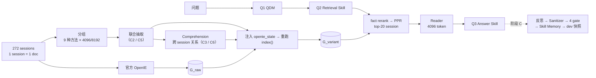
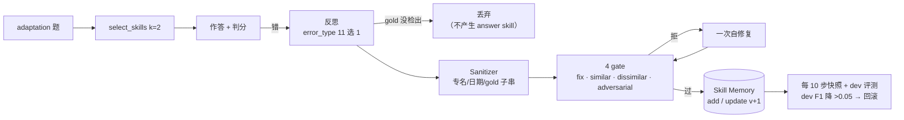

# 02 · LoCoMo（长对话记忆）— 阶段 A / B / C

> **时间**：2026-11-05 → 11-10 · **机器**：devcloud · **LLM**：HY4（`no_think`，T=0）· **Embedding**：NV-Embed-v2 · **底座**：官方 HippoRAG2（未改动）
>
> **一句话结论**：图变体和 Question-Time 都能把检索往上推（test R@5 .864→.885），但 QA 基本不动（8 种组合的 F1 都在 .472–.494）。conv-30 的 Oracle 实验显示瓶颈在 Reader。Comprehension 独立救回的只有 1 题（q16）。RSI 闭环能跑通，但在 43 题上为负。LoCoMo 太小、太饱和，不适合作为主证据。

| 阶段 | 范围 | 问的问题 | 结论 |
|---|---|---|---|
| **A** 全链路（P0/P1/P2） | 10 段对话 / 1,986 题 | 分组、联合抽取、理解层、Question-Time 有没有用？ | 检索 ↑，QA 持平；聚类没有必要 |
| **B** conv-30 Prompt 优化 | 105 题 | 90 题有机会、只兑现 1 题，原因是知识不够还是 Reader 不会用？ | Reader 是瓶颈（P7：F1 +13.1pp）；新关系很难进入 top-5 fact |
| **C** conv-30 RSI 闭环 | 43/19/43 三分 | 不改权重的技能记忆能否泛化？ | 机制可行，效果为负（E2 F1 .508 < 固定 P7 .563） |

**目录**：[1 数据集](#1-数据集) · [2 实验方法](#2-实验方法) · [3 阶段 A 结果](#3-阶段-a全链路1986-题) · [4 阶段 B 结果](#4-阶段-bconv-30-prompt-优化) · [5 阶段 C 结果](#5-阶段-crsi-skill-自进化闭环) · [6 Case 分析](#6-case-分析) · [7 已完成--未完成](#7-已完成--未完成) · [8 问题归因](#8-问题归因数据集还是方法) · [9 复现](#9-复现) · [10 文件索引](#10-文件索引)

---

## 1. 数据集

### 1.1 为什么从 MuSiQue 换到 LoCoMo

MuSiQue 的 Wiki 片段之间没有连续的"世界"，跨文档理解没有可生长的空间（见 [01_musique_wiki](../01_musique_wiki/README.md)）。LoCoMo 是两个人跨数月的多 session 对话，天然带有**状态变化、时间顺序、计划→结果、跨 session 指代**，这些正是 Read-Time Comprehension 想抓住的知识。

### 1.2 规模（`outputs/reports/DATASET_AUDIT.md`）

| 指标 | 值 |
|---|---|
| Conversation | 10 |
| Session（= 检索文档） | 272（每段对话 19–32 个） |
| Turn | 5,882 |
| QA | **1,986**（dev 502 = conv-30/44/48；test 1,484 = 其余 7 段） |
| Session token | 均值 684.8，中位数 642，最大 1,397 |
| **单段对话全文** | **11,435 – 21,979 token**（HY4 上下文完全装得下） |
| **金标准** | **有**：turn 级 `dia_id`（如 `D10:1`），映射到 session；8 个 `dia_id` 无法映射，4 题无 evidence |
| **每题 gold** | 平均 **1.42** 条证据；跨 session 多证据题 328 道（**16.5%**） |

| category | 名称 | 全量 | dev | test | conv-30 |
|---|---|---|---|---|---|
| 1 | multi-hop | 282 | 62 | 220 | 11 |
| 2 | temporal | 321 | 92 | 229 | 26 |
| 3 | open-domain | 96 | 17 | 79 | **0** |
| 4 | single-hop | 841 | 224 | 617 | 44 |
| 5 | adversarial（应拒答） | 446 | 107 | 339 | 24 |

> **防泄漏**：LoCoMo 自带的 `session_summary` / `observation` / `event_summary` 是人工摘要，**从未进入任何索引或生成路径**；分组和抽取只用原始对话文本（`src/dataset/locomo.py`）。

### 1.3 一道题长什么样（q16，conv-30）

```text
Q:      When did Jon go to a fair to get more exposure for his dance studio?
Gold:   24 April, 2023          Evidence: D10:1  →  session s10
Session 文本格式:  [Session 10 | 24 April, 2023]
                   Jon: ... went to a fair to show off my studio ...
```

- 这是一道 temporal 题，答案就是 session header 的日期。难点在于把 s10 检索进 4096-token 预算。
- G_raw 把 s10 排在第 9，Reader 回答 `No answer`。C3/C6 借助一条跨 session 的 Composed 关系把 s10 拉到第 4/第 3，答案正确（详见 [§6](#6-case-分析)）。

### 1.4 别的工作做到多高（口径不同，仅供定位）

| 系统（Mem0 论文协议：GPT-4o-mini judge，类别 1–4，1,540 题） | LLM-Judge J |
|---|---|
| Full-context | 72.9 |
| Mem0ᵍ / Mem0 | 68.4 / 66.9 |
| Zep | 66.0 |
| 最好的 RAG 配置 | 61.0 |
| A-Mem | 48.4 |

我们报告的是 **SQuAD 风格 EM/F1**（类别 1–4，类别 5 单独算拒答率），另外复刻了**官方 LoCoMo F1**（带词干化）。两者都不能和 LLM-Judge 的 J 直接比较，详见 [docs/REFERENCE_NUMBERS.md](../../docs/REFERENCE_NUMBERS.md)。

---

## 2. 实验方法

### 2.1 框架



### 2.2 基线

| 基线 | 定义 |
|---|---|
| Dense RAG | NV-Embed-v2 问题向量 → session cosine top-20 → Reader |
| HippoRAG2 G_raw | 官方 OpenIE → entity/fact/passage 图 + 同义边 → LLM fact rerank + PPR → top-20 → Reader |
| Full-Context | 整段对话（11k–22k token）一次性给 Reader，不是等预算比较 |

### 2.3 Read-Time 变体（阶段 A）

| 变体 | 阅读组织 | 抽取 | 理解层 | 用来隔离 |
|---|---|---|---|---|
| C0/C1 | 单 session | 官方 OpenIE | — | 基线（C1 = C0，不单独报告） |
| C2 | 聚类组（hybrid_0.5 / 8192） | 联合抽取 | — | `C2 − G_raw` = 联合抽取 |
| C3 | 同 C2 | 联合抽取 | **跨 session 关系** | `C3 − C2` = 理解层 |
| C5 | 整段对话 1 组 | 联合抽取 | — | 全文 vs 聚类 |
| C6 | 整段对话 1 组 | 联合抽取 | **有** | `C6 − C5` = 理解层 |

**怎么做"理解"**：在每个阅读组上，让 LLM 先读联合抽取得到的原子事实和带 `dia_id` 的原文，再输出跨 session 关系：

```text
subject / predicate / object / relation_type / source_dia_ids / supporting_fact_ids /
evidence（逐字，≤25 词/条）/ derivation ∈ {Explicit, Composed, Inferred} / confidence
```

- 硬约束：每条关系必须引用 ≥2 个不同 session 的 `dia_id`，否则丢弃（`needs_two_sessions`）。
- `Composed` 表示由原文事实组合即可得到；`Inferred` 表示需要常识推理。
- 关系只进图，**不进 Reader prompt**，所以它只能通过检索排序起作用，不存在文本泄漏。
- 注入方式：按内容哈希找到 chunk，把关系追加到 `openie_state.json` 的 `extracted_triples`，再重跑官方 `index()`，期间没有新的 OpenIE 调用（`src/graph/variants.py`，细节见 [METHOD.md](../../docs/METHOD.md#2-图变体注入)）。

**conv-30 图规模**（与 `openie_state.json` 和 `get_graph_info()` 双向核对）：

| 图 | phrase 节点 | 抽取三元组 | 同义边 | 总边数 | 三元组增幅 |
|---|---|---|---|---|---|
| G_raw | 441 | 600 | 741 | 1,733 | — |
| C2 | 552 | 787 | 1,090 | 2,343 | +31% |
| C3 | 570 | 813 | 1,108 | 2,434 | +36% |
| C5 | 532 | 735 | 901 | 2,095 | +23% |
| C6 | 559 | 753 | 938 | 2,213 | +26% |

### 2.4 Question-Time（阶段 A）

| 策略 | 流程 | 参数 |
|---|---|---|
| Q0 | 原问题 → 检索 → Reader | top-20 |
| Q1 | **QDM**：判断是否拆解 → 每个子问题各自检索 → RRF 合并 | ≤4 个子问题；解析失败时不拆解（fail-closed） |
| Q2 | Q1 + **Retrieval Skill**：看 top-5 结果，诊断缺失的关系链，补充 ≤2 个查询 → RRF | `max_new=2` |
| Q3 | Q2 + **Answer Skill**：证据校验、修订、可拒答 | 输出 `{answer, answerable, support}` |

RRF：`score(d) = Σ 1/(60 + rank + 1)`（rank 从 0 开始）。联合实验做 `R{G_raw, C6} × Q{0,1,2,3}`，在 test 全量上跑 2×4。

### 2.5 阶段 B / C 的追加设计

| 阶段 | 改什么 | 怎么隔离 |
|---|---|---|
| B · Reader | P0–P8 九个 Reader prompt | 固定 G_raw 的 4096 上下文；dev 40 / val 65；`selection.json` 在跑 val 之前写入 |
| B · Oracle | Gold evidence / 全对话 / 正常检索 × P0/P7 | 区分"找不到"和"读不懂" |
| B · Comprehension | COMP-P0..P5 六个关系 prompt | 固定 C2 的 228 条三元组，只换关系 prompt |
| B · 检索路径 | 复现官方 `retrieve()` 中间态；`use_llm_rerank=False` 消融 | `src/prompt_optimization/retrieval_diag.py`，不改官方代码 |
| C · RSI | Answer Skill / Retrieval Skill 进化；ReAct + Grounded Verifier | seed 20261110 分层三分 43/19/43；只在 adaptation 上学，dev 选快照，evaluation 只读一次 |

---

## 3. 阶段 A：全链路（1,986 题）

### 3.1 基线

| 方法 | EM（可答） | F1（可答） | R@5 | R@20 | 证据@4096 | 证据@8192 | 拒答率（cat5） |
|---|---|---|---|---|---|---|---|
| Dense | .221 | .436 | .791 | .980 | .742 | .879 | .946 |
| **HippoRAG2 G_raw** | .244 | .483 | **.863** | .987 | **.828** | **.916** | .953 |
| Full-Context | **.245** | **.491** | — | — | — | — | .915 |

**按类别：检索提升没有传导到答案**

| category | n | R@5 Dense → HippoRAG | 证据@4096 Dense → HippoRAG | F1 Dense → HippoRAG |
|---|---|---|---|---|
| multi-hop | 282 | .559 → .676 | **.274 → .441（+16.7pp）** | .353 → .393（+4.0pp） |
| temporal | 321 | .815 → .888 | .773 → **.875** | .214 → **.238** |
| open-domain | 96 | .615 → .668 | .506 → .584 | .155 → .172 |
| single-hop | 841 | .847 → .936 | .850 → .937 | .580 → .642 |

- temporal 题证据覆盖已有 .875，F1 却只有 .238，说明证据都在，模型算不对相对时间。
- 跨对话 HippoRAG EM 的极差是 .317–.479（16pp），所以 1–2pp 的整体差异都按噪声处理。

### 3.2 分组（gold 是否落在同一阅读组）

| 方法（8192 预算） | gold full | gold partial | 跨 session 共置 |
|---|---|---|---|
| random（5 seeds） | .883 | .947 | .304 |
| temporal | .883 | .948 | .305 |
| entity_jaccard | .886 | .948 | .249 |
| **entity_idf** | **.905** | **.958** | **.431** |
| embedding | .884 | .946 | .259 |
| hybrid_0.5 | .881 | .946 | .281 |
| community（Louvain） | .854 | .918 | .086 |

- 随机分组已有 .883，所有聚类方法在 .854–.905 之间，**聚类没有必要**。
- 唯一稳定的信号是 `entity_idf` 的跨 session 共置（.431 vs .304），但没有转化成端到端 QA 优势。
- `community` 最差：社区太小（平均 1,430 token），粒度和阅读预算不匹配。
- 4096 预算下结论相同。全部组合见 `outputs/reports/FINAL_TABLES.md`。

### 3.3 Read-Time 变体

| 方法 | dev EM / F1 | dev R@5 / 证据 | **test EM / F1** | **test R@5 / 证据** |
|---|---|---|---|---|
| G_raw | .253 / .481 | .858 / .819 | .240 / .484 | .864 / .831 |
| Full-Context | .261 / .486 | — | .239 / **.493** | — |
| C2 聚类联合抽取 | .253 / .488 | .868 / .837 | .241 / .490 | .875 / .838 |
| C3 聚类 + 理解 | .261 / .492 | .873 / .849 | .238 / .484 | **.881** / .842 |
| C5 全文联合抽取 | **.271** / .500 | .881 / .845 | **.245** / .489 | .874 / .841 |
| C6 全文 + 理解 | .268 / **.501** | **.883** / .847 | .243 / .492 | **.881** / **.849** |

| 结论 | 证据 |
|---|---|
| 联合抽取拿到了几乎全部检索增益（H2 成立） | C5 vs G_raw：test R@5 .864→.874 |
| 理解层没有额外 QA 收益（H3 不成立） | test 上 C3−C2 EM −0.3pp，C6−C5 −0.2pp |
| 全文 ≥ 聚类 | C5/C6 ≥ C2/C3；Full-Context .493 ≈ 最好的图 .492 |
| 检索成立、QA 不成立（H4） | 证据 +0.7~1.8pp；EM/F1 差异 ≤ ±0.5pp；逐对话 F1 4 升 3 降 |

**消融：Composed vs Inferred（dev 502）**

| 图 | EM | F1 | R@5 | 证据@4096 |
|---|---|---|---|---|
| G_raw | .253 | .481 | .858 | .819 |
| **Composed-only** | **.266** | **.501** | .869 | .845 |
| Inferred-only | .253 | .494 | **.875** | .841 |
| C3（两者合并） | .261 | .492 | .873 | **.849** |

可验证的组合（Composed）带来最好的 QA；语义推断（Inferred）只提升检索，更像检索噪声。

**关系质量审计（717 条）**：A 与 G_raw 重复 0、B 同义改写 1、C 单 session 可得 0、**D 跨 session 且有双证据 688（95.9%）**、E 低置信 28（3.9%）。
注意：审计用的是词面匹配（exact + 0.85 字符相似度），语义重复可能被低估。

### 3.4 Question-Time 与联合矩阵

| test（1,484） | Q0 原问题 | Q1 QDM | Q2 +Retrieval Skill | Q3 +Answer Skill |
|---|---|---|---|---|
| **G_raw** | .240 / .484 / .864 / .831 | .237 / .483 / .860 / .826 | .236 / .489 / .870 / .831 | .238 / .472 / .868 / .833 |
| **C6** | .243 / .492 / .881 / .849 | **.244 / .494** / .876 / .843 | .239 / .491 / **.885** / **.851** | .238 / .479 / .884 / .852 |

格式：`EM / F1 / R@5 / 证据@4096`

- **检索单调改善**（R@5 .864→.885），但 8 格的 EM 都在 .236–.244，F1 都在 .472–.494。
- 检索最好的 R1Q2/R1Q3 在 QA 上不如 R1Q1 → **H6（两条路线互补）不成立**。两条路线在推同一个中间量（召回），而 R@20 已达 .986，接近天花板。
- **Retrieval Skill 过度触发**：dev 92.2%、test 92.5% 的题都触发，平均每题追加 1.26 个查询。它没有学会判断"证据已经够了"。
- conv-30 上 Q3 的 +3.7pp F1 在 conv-44/48 和 test 上都不复现，属于单对话波动。
- 第一版 Skill Evolution（E4）其实是 `(category, 后缀)` 网格选择。test R@5 +0.59pp，没有跑 Reader，不能算 RSI。

### 3.5 "机会 → 兑现"漏斗（conv-30，阶段 A 最重要的机制数字）

```text
gold session 上至少挂了 1 条新关系          C3 100/105   C6 99/105
  └─ 关系文本与问题有词面重叠                    90/105      75/105
      └─ gold 名次真的变好                          3            3
          └─ 答案由错变对（可归因）                  1 (q16)      1 (q16)
```

---

## 4. 阶段 B：conv-30 Prompt 优化

范围：conv-30，19 session / 105 题（81 道可答 + 24 道对抗）。动机是追查阶段 A 中"90 题有机会只兑现 1 题"的原因。

### 4.1 先审计：问题出在哪

| 审计 | 关键发现 |
|---|---|
| **Reader prompt** | 强制短 span + 严格拒答；没有截断；context 按检索名次而非时间排序；看不到 turn id |
| **Comprehension prompt** | 26 条里 17 条（65%）是 `temporal_ordering`，集中在已饱和的题型；只有 7/26 条两端都是图中已有实体；谓词平均 5.2 词 |
| **检索路径**（最重要） | 官方 `retrieve()`：fact 点积取 top-5 → **每题一次 LLM rerank** → 若过滤为空，整题退化成 dense（top-1 分数恰为 1.0）→ 否则以 fact 实体为种子做 PPR。**新关系必须先进入 top-5 fact 并通过 rerank，才可能影响排序。** |
| **评测口径** | 官方 LoCoMo F1 比项目 F1 高 2.9–4.1pp（主要来自词干化，如 `Hoodies→hoodie`）；EM 几乎相同 |

**错误归因（G_raw + P0，81 道可答题）**：17 题正确；**69 题证据完整进入上下文，其中 53 题仍然答错**。

| 主错误 | 题数 | 占错误 |
|---|---|---|
| E 答案表达（过短、措辞不同、部分正确） | 23 | 35.9% |
| F **过度拒答**（证据完整却回答 No answer） | 13 | 20.3% |
| A 检索错误（gold 不在上下文里） | 11 | 17.2% |
| C 时间推理错误 | 9 | 14.1% |
| G 幻觉 / D 多事实整合 / B 证据不完整 | 4 / 3 / 1 | 12.5% |

### 4.2 Oracle 诊断（本阶段最关键的对照）

| 上下文 | P0 F1 | P7 F1 | 平均 token |
|---|---|---|---|
| 正常 G_raw 检索 | .390 | .521 | 3.9k |
| **Gold evidence（Oracle）** | **.387** | **.603** | 761 |
| 整段对话 | .360 | .546 | 11.4k |

1. **P0 拿到 gold 也没变好**（.390 → .387），所以瓶颈不在检索，在 Reader。
2. P7 在 Oracle 上 +8pp，说明 Reader 改好之后，检索还有 4–8pp 可以兑现。
3. 整段对话不如 Oracle，上下文越多干扰越大。

### 4.3 Reader prompt（P0–P8）

| Prompt | 设计 | dev40 EM / F1 | 结果 |
|---|---|---|---|
| P0 | 现网：短 span + 严格拒答 | .235 / .394 | 基线 |
| P1 / P2 / P5 | 完整句 / 先整合 / 按题型 | .000–.088 / .18–.35 | 答案变成 20–25 词长句，EM 崩 |
| P3 | 强化时间规则 | .206 / .444 | temporal 大涨，但对抗题拒答率变成 0% |
| P4 | 拒答校准 | .147 / .364 | EM 下降 |
| P6 | 官方 LoCoMo 风格 | .147 / .523 | F1 高、EM 不升（日期带 "around"） |
| **P7** | **P0 + P3 + P6 综合** | **.294 / .600** | **唯一同时抬高 EM / F1 / 官方 F1 的方案** |
| P8 | P7 + 前提检查 | .206 / .504 | 对抗题拒答恢复到 100%，EM 掉 |

全 105 题：P0 → P7 的 EM .210→.235，**F1 .390→.521（+13.1pp）**，官方 F1 .426→.546。
按类别看：temporal F1 **.292→.818**，single-hop F1 .423→.349（答案变长）。所以 P7 不是全面提升。P7 全文见 [主报告 §6.5](../../docs/RSI_GraphRAG_FULL_METHOD_AND_EXPERIMENTS.md#65-reader-prompt-实验p0p8)。

**噪声标尺**：同 prompt、同 context、T=0 跑 3 次，P0 的 EM 在 .214/.286/.357 之间波动；P7 措辞会变，但得分稳定。105 题上 1–2 题的差异属于噪声。

### 4.4 Comprehension prompt（COMP-P0..P5）

| Prompt | 设计 | 关系数 | R@5 | MRR | Ev@4096 | 进入 top-5 fact 的题数 |
|---|---|---|---|---|---|---|
| C2（无理解） | — | 0 | .9032 | .7586 | .8952 | — |
| COMP-P0（原版 C3） | 无约束 | 26 | .9079 | .7575 | .9048 | — |
| P1 证据组合 | 只留必须跨 session 的 | 14 | .9103 | .7547 | .8952 | 8 |
| P2 跨 session 桥 | plan→outcome 等 | 19 | .9079 | .7598 | .8952 | 7 |
| P3 事件 / 状态追踪 | 先建时间线 | 27 | .9079 | .7579 | .8952 | 11 |
| **P4 面向检索** | 短实体、1–4 词谓词、对齐已有实体 | 16 | **.9127** | **.7638** | **.9048** | 5 |
| P5 生成 → 验证 | verifier 逐条审 | 7 | .9032 | .7582 | .8952 | 3 |

- COMP-P4 最好，但收益**恰好是 1 题（q16）**，且零负迁移（93 道原本成功的题没有一道丢失证据）。
- **11 道真正跨 session 的 multi-hop 题，证据覆盖完全没变（.455 → .455）。** 为"跨 session 理解"设计的 prompt，救回的是一道单 session 的时间题。
- **数量控制**：P4 只保留置信度最高的 10 条，所有指标不变。P3 有 27 条却没有收益。关系数量与收益没有单调关系。
- **漏斗（H9）**：99 题有触及 gold 的关系 → 5 题进入 top-5 fact → 1 题兑现。

### 4.5 关闭 LLM fact reranker

| 图 / 设置 | R@5 | MRR | Ev@4096 | dense 回退 |
|---|---|---|---|---|
| C2 官方 rerank | .9032 | .7586 | .8952 | 16 |
| COMP-P4 官方 rerank | .9127 | .7638 | .9048 | 15 |
| **COMP-P4 no-rerank top5** | **.9294** | .7224 | **.9143** | **0** |
| COMP-P4 no-rerank top20 | .8056 | .6303 | .7905 | 0 |

- 关掉 rerank 后，MRR 降 3–4pp，但 Comprehension 的收益从 +1 题翻倍到 +2 题（q16、q57）。rerank 压制了 q57/q44 上本可用的证据。
- top20 种子会让 PPR 主题漂移，明显更差。
- **阶段 B 最佳组合**：COMP-P4 + no-rerank top5 + P7 → **EM .259 / F1 .539 / 官方 F1 .569**，每图 0 次 rerank 调用。这个组合成为阶段 C 的固定底座 `COMP-P4_top5`。

### 4.6 Graph × Reader 拆解

| 实验 | 图 | Reader | EM | F1 | 官方 F1 |
|---|---|---|---|---|---|
| E0 | G_raw | P0 | .210 | .390 | .426 |
| E1 | G_raw | P7 | .235 | .521 | .546 |
| E2 | COMP-P4 | P0 | .210 | .387 | .425 |
| E3 | COMP-P4 | P7 | .247 | .524 | .539 |
| 对照 | C2 | P7 | .235 | .515 | .530 |

- **Prompt 带来的收益**：E1−E0 = F1 +13.1pp，是全阶段最大且最稳的单项收益。
- **Comprehension 带来的收益**：E3 vs C2+P7 = EM +1.2pp，**即 1 道题**。
- 两者基本可加，Reader 占绝大部分。Comprehension 修的是"证据到达"，Reader 修的是"证据 → 答案"。

---

## 5. 阶段 C：RSI Skill 自进化闭环

**固定底座**：`COMP-P4_top5` 排序 + 4096 上下文 + P7 Reader。
**划分**（seed 20261110，按类别分层，在学习任何技能之前生成）：

| 子集 | n | multi-hop | temporal | single-hop | adversarial | 用途 |
|---|---|---|---|---|---|---|
| adaptation | 43 | 4 | 11 | 18 | 10 | 唯一允许学习的集合 |
| development | 19 | 2 | 5 | 8 | 4 | 只用于快照选择和回滚 |
| evaluation | 43 | 5 | 10 | 18 | 10 | 最终只读一次 |

### 5.1 Answer Skill 进化循环



| gate | 通过条件 |
|---|---|
| `fix_pass` | 源题 F1 提升 ≥0.10，或 EM 从 0 变 1 |
| `similar_pass` | ≤3 道同类相似题中，没有一道由对变错 |
| `dissimilar_pass` | 另外 3 个类别各取 1 题，没有一道由对变错 |
| `adversarial_pass` | ≤2 道对抗题，原本拒答的不能变成不拒答 |

Retrieval Skill 同理：只能追加查询模板（占位符 `{question}` / `{entities}`），先经过 sufficiency gate，验证时只做本地 dense replay，不调 LLM。ReAct + Grounded Verifier（R0–R5）只看问题、同一份上下文和候选答案。完整状态机见 [METHOD.md §6](../../docs/METHOD.md#6-rsi-skill-memory-闭环)。

### 5.2 结果（evaluation，n=43；1 题 ≈ 2.3pp EM）

| Exp | Answer 层 | Retrieval 层 | EM | F1 | 官方 F1 | Ev@4096 | R@5 | 调用/题 |
|---|---|---|---|---|---|---|---|---|
| **E0** | P7 | base | **.303** | **.563** | **.606** | **.909** | **.932** | 1.0 |
| E1 | 静态手写规则 | base | .273 | .423 | .436 | .909 | .932 | 1.0 |
| E2 | **进化** answer | base | .273 | .508 | .574 | .909 | .932 | 1.0 |
| E3 | P7 | 静态检索库 | .303 | .545 | .576 | .818 | .803 | 3.0 |
| E4 | P7 | 进化检索（实际 0 条）+ QDM | .273 | .546 | .602 | .848 | .886 | 3.0 |
| E6 | 进化 answer | 进化检索 | .273 | .506 | .589 | .848 | .886 | 3.0 |
| EB | 长静态 prompt | base | .303 | .488 | .523 | .909 | .932 | 1.0 |

| ReAct | R0 | R1 +verifier | R2 +QDM 检索 | R3 进化 answer | R4 +verifier | R5 全进化 |
|---|---|---|---|---|---|---|
| F1 | .562 | .549 | .520 | .484 | .490 | **.425（最差）** |
| 修订率 | 0 | .395 | .535 | 0 | .326 | .442 |

### 5.3 学到了什么

| 学到的技能 | 类别 | eval 命中 | 有帮助 | 有害 |
|---|---|---|---|---|
| `ans_use_explicit_caused_state_wording` | single-hop | 18 | 1 | 0 |
| `ans_return_concise_explicit_purpose_for_why_` | single-hop | 18 | 1 | 0 |
| `ans_preserve_temporal_granularity_for_relati` | temporal | 10 | 0 | **1**（q38） |
| `ret_motivation_and_trigger_expansion_for_why`（检索） | multi-hop | — | — | **被 dev 快照否决**（dev 证据 .933→.867） |

- adaptation 上：候选 11 条，接受 3 条，sanitizer 拦掉 6 条（全部是泄漏检查），自修复 5 次全部失败，回滚 0 次。
- evaluation 上：**28/43 题命中技能 → 1 题有帮助、1 题有害、26 题中性**。
- 技能按类别触发，被应用到大量触发条件并不匹配的题上。
- 唯一的正向机制证据：检索技能在 adaptation 上通过了验证，但会降低 dev 的证据覆盖，被快照选择正确拦下。

---

## 6. Case 分析

所有 case 来自真实产物：`outputs/reports/cases_conv30_*.json`、`outputs/prompt_optimization_conv30/cases/cases.md`、`outputs/question_evolution_conv30/error_analysis.md`。

### ✅ q16：唯一完整的"关系 → 检索 → 答对"闭环

| 方法 | Top-5 | s10 名次 | Ev@4096 | 答案 |
|---|---|---|---|---|
| G_raw | s05, s09, s11, s02, s18 | 9 | 0 | `No answer` ❌ |
| C2 / C5 | s18, s05, s01, s02, s17（dense 回退） | 8 | 0 | `No answer` ❌ |
| **C3** | s08, s11, s18, **s10**, s15 | **4** | 1 | `24 April, 2023` ✅ |
| **C6** | s08, s11, **s10**, s18, s05 | **3** | 1 | `24 April, 2023` ✅ |
| COMP-P4 | s10 排第 1 | **1** | 1 | ✅（P0 也能答对） |

- 起作用的关系：`Jon --attended_fair_before--> worked_on_opening dance studio`（Composed，conf 0.88，sessions [10, 15]）。COMP-P4 中对应 `Jon's fair attendance --generated_leads_for--> Jon's dance studio`。
- 消融验证：只保留 Composed 能复现；只保留 Inferred 会退回 dense 回退。
- C2 失败不是排错，而是根本没进 PPR：fact 被 rerank 全部过滤，整题退化成 dense。

### ⚠️ q31：检索到位，多跳算术没到位

`How long did it take for Jon to open his studio?` gold `six months`（需要 s1 + s15）。
关系 `Jon's dance studio --opened_after--> Jon searched for ideal spot` 把 s15 从第 4 拉到第 1。但答案需要用 s15 和 s1 的日期做差，Reader 仍然回答 `No answer`。

### ❌ q24 / q29：新知识把证据挤出预算

- **q24**（gold `fair, networking events, dance competition`，需要 s8/s10/s16）：COMP-P1/P3 下 s10 掉到第 7，4096 预算装不下，被挤出。
- **q29**（gold `Paris, Rome`，需要 s2 + s15）：C5/C6 下 s15 从第 3 掉到第 9，答案退化成 `Paris`。
- 机制：问题不在关系内容错，而在新增的实体和边改变了 fact 候选与 PPR 权重。

### ❌ q54："往图里塞知识"的副作用

`How is Gina's store doing?`（短、泛、无实体）。G_raw 中 s04 排第 1；C2/C3 中掉到第 9（dense 回退）。C2 和 C3 结果完全相同，所以不是理解层的错，是 fact 候选池被改变了。

### ❌ q85 / q33 / q38：Reader 和技能的失败

| qid | 现象 | 原因 |
|---|---|---|
| q85 | 对抗题（Gina 是否参加舞蹈节），P7 回答"很兴奋" | 前提检查不足；P8 能修，但 dev EM −8.8pp |
| q33 | gold `20 June`，P7 答 `21 June` | 证据说 "yesterday"，P7 直接用了 session 日期，没减 1 天 |
| q38 | gold `21 July 2023`，E2 答 `Last Friday` | 学到的"保留时间粒度"技能被过度应用 |

### 📏 噪声标尺

C3 和 C3-composed 在 98/105 题上的上下文集合完全相同，其中 6 题（q0, q24, q33, q47, q74, q85）EM 不同，4 题连文档顺序都相同。**任何 ≤2 题的 EM 翻转都不能单独作为方法有效的证据。**

---

## 7. 已完成 / 未完成

| 状态 | 项目 |
|---|---|
| ✅ | 基线 Dense / G_raw / Full-Context 全量；9 种分组 × 2 预算；C2/C3/C5/C6 dev+test；Composed/Inferred 消融；717 条关系审计 |
| ✅ | Q0–Q3 dev+test；R×Q 2×4 test；第一版 Skill Evolution（网格选择） |
| ✅ | conv-30：错误归因、Oracle、P0–P8、COMP-P0..P5、数量控制、no-rerank 消融、Graph×Reader、重复运行 |
| ✅ | conv-30：RSI 三分、Answer/Retrieval Skill 进化、E0–E6、R0–R5、两次重复运行 |
| ⬜ 未做 | C3v（LLM 验证变体）端到端：抽取产物缺失 |
| ⬜ 未做 | 按类别分层改造 Reader（时间推理、多跳整合）：被认为最有价值，本轮没做 |
| ⬜ 未做 | 阶段 B/C 的结论推广到其它 9 段对话：目前只在 conv-30 上成立，且 conv-30 被前序轮次研究过 |
| ⬜ 未做 | 更强的 Reader（换模型或开思维链）：为保证可比性限定 HY4 `no_think` |
| ⬜ 未做 | LLM-Judge（Mem0 协议）口径：没有复刻，所以不能和 Mem0/Zep 直接比 |
| ⬜ 未做 | 更长语料（Multi-LoCoMo / NarrativeQA）：后来转向了 QASPER 和 DetectiveQA |

---

## 8. 问题归因：数据集还是方法？

| 问题 | 证据 | 归因 |
|---|---|---|
| **池太小、检索已饱和** | 每段对话只有 19–32 个 session；R@20 = .986；conv-30 的 R@20 恒为 100% | **数据集** |
| **全文能直接装下** | 单段对话 11k–22k token；Full-Context .493 ≈ 最好的图 .492 | **数据集** |
| **题太少，1 题 ≈ 1pp** | conv-30 只有 81 道可答题；阶段 C 的 evaluation 只有 33 道可答题；跨对话 EM 极差 16pp | **数据集** |
| **真正跨 session 的题少** | 多证据题只占 16.5%；conv-30 的 multi-hop 只有 11 题，open-domain 为 0 | **数据集** |
| **Reader 是硬上限** | Oracle+P0 .387 ≈ 正常 .390；69 题证据完整，53 题仍错 | **方法**（Reader） |
| **新关系竞争不过普通 fact** | 99 → 5 → 1 漏斗；rerank 还会压制正确证据 | **方法**（表示与融合） |
| **新知识挤出证据** | q24 / q29 / q54 | **方法**（融合设计） |
| **技能过度触发** | Retrieval Skill 触发率 92%；28 题命中只有 1 题有帮助；q38 | **方法**（Question-Time） |
| **评测口径脆弱** | 同一答案在三种口径下可以是 0 / 1 / 0.667 | 评测 |

**结论**：LoCoMo 对"跨文档理解"这个 claim 的分辨率不够。方法差异落在 1–2 题的噪声带里，所以我们去找文档更多、需要跨段理解的数据集（[QASPER](../03_qasper/README.md) → [DetectiveQA](../04_detectiveqa/README.md)）。同时，Reader 上限、关系竞争不过普通 fact、新知识挤出证据这三个方法问题在后续数据集上继续出现。

---

## 9. 复现

```bash
# devcloud: cd /group/40150/licochen/Memory/RSI_GraphRAG && source .venv/bin/activate
python scripts/prepare_data.py                 # LoCoMo → data/processed/<conv>/sessions.jsonl + data/splits/split.json
bash scripts/run_all.sh                        # 阶段 A：baselines → grouping → read-time → question-time → joint
python scripts/build_final_tables.py           # → outputs/reports/FINAL_TABLES.md, metrics.csv

# 阶段 B：按编号顺序执行
python scripts/prompt_opt/00_official_metrics.py
python scripts/prompt_opt/04_reader_pilot.py   # 跑 val 之前冻结 reader/pilot/selection.json
python scripts/prompt_opt/05_comp_generate.py && python scripts/prompt_opt/06_comp_graphs_retrieval.py
python scripts/prompt_opt/18_no_llm_rerank.py && python scripts/prompt_opt/19_comprehensive_report.py

# 阶段 C
cd outputs/question_evolution_conv30
python -m qecode.s0_split && python -m qecode.answer_evolve && python -m qecode.retrieval_evolve   # 然后 s3..s7
```

逐步命令见 [主报告 §12](../../docs/RSI_GraphRAG_FULL_METHOD_AND_EXPERIMENTS.md#12-复现)。

---

## 10. 文件索引

| 想看 | 文件 |
|---|---|
| **完整报告（推荐）** | [主报告 §3.1、§5–§7](../../docs/RSI_GraphRAG_FULL_METHOD_AND_EXPERIMENTS.md) |
| 阶段 A 入口 | [outputs/reports/START_HERE.md](../../outputs/reports/START_HERE.md) · [MASTER_REPORT.md](../../outputs/reports/MASTER_REPORT.md) · [FINAL_EXPERIMENT_REPORT.md](../../outputs/reports/FINAL_EXPERIMENT_REPORT.md) |
| 阶段 A 结果表 | [FINAL_TABLES.md](../../outputs/reports/FINAL_TABLES.md) · [metrics.csv](../../outputs/reports/metrics.csv) |
| 数据集审计 / 分组 | [DATASET_AUDIT.md](../../outputs/reports/DATASET_AUDIT.md) · [GROUPING_REPORT.md](../../outputs/reports/GROUPING_REPORT.md) |
| Read-Time / Question-Time / 联合 | [READ_TIME_REPORT.md](../../outputs/reports/READ_TIME_REPORT.md) · [QUESTION_TIME_REPORT.md](../../outputs/reports/QUESTION_TIME_REPORT.md) · [JOINT_EVALUATION.md](../../outputs/reports/JOINT_EVALUATION.md) |
| 理解层质量 / conv-30 机制 | [COMPREHENSION_AUDIT.md](../../outputs/reports/COMPREHENSION_AUDIT.md) · [CONV30_READTIME_ANALYSIS.md](../../outputs/reports/CONV30_READTIME_ANALYSIS.md) |
| 阶段 B 报告 | [FINAL_REPORT](../../outputs/prompt_optimization_conv30/reports/FINAL_REPORT.md) · [COMPREHENSIVE_REPORT](../../outputs/prompt_optimization_conv30/reports/COMPREHENSIVE_REPORT.md) · [EXPERIMENT_LOG](../../outputs/prompt_optimization_conv30/reports/EXPERIMENT_LOG.md) |
| 阶段 B case / 审计 | [cases.md](../../outputs/prompt_optimization_conv30/cases/cases.md) · [error_analysis_summary.md](../../outputs/prompt_optimization_conv30/audit/error_analysis_summary.md) · [official_metric_comparison.md](../../outputs/prompt_optimization_conv30/audit/official_metric_comparison.md) |
| 阶段 C 报告 | [README](../../outputs/question_evolution_conv30/README.md) · [FINAL_REPORT](../../outputs/question_evolution_conv30/FINAL_REPORT.md) · [COMPREHENSIVE_REPORT](../../outputs/question_evolution_conv30/COMPREHENSIVE_REPORT.md) |
| 阶段 C 细节 | [answer_skill_evolution](../../outputs/question_evolution_conv30/answer_skill_evolution.md) · [retrieval_skill_evolution](../../outputs/question_evolution_conv30/retrieval_skill_evolution.md) · [joint_experiments](../../outputs/question_evolution_conv30/joint_experiments.md) · [react_and_verification](../../outputs/question_evolution_conv30/react_and_verification.md) · [error_analysis](../../outputs/question_evolution_conv30/error_analysis.md) |
| 技能记忆原文 | [skill_memory.jsonl](../../outputs/question_evolution_conv30/skill_memory.jsonl) · [retrieval_skill_memory.jsonl](../../outputs/question_evolution_conv30/retrieval_skill_memory.jsonl) · `skill_snapshots/` |
| 逐题预测 | `outputs/qa/`（阶段 A，按方法 × 对话）· `outputs/prompt_optimization_conv30/{reader,joint}/` · `outputs/question_evolution_conv30/qa_predictions.jsonl` |
| 理解层产物 / 分组 | `outputs/comprehension/<conv>/` · `outputs/groupings/<conv>/` |
| 代码 | `src/dataset/locomo.py` · `src/grouping/` · `src/comprehension/` · `src/graph/variants.py` · `src/question_skill/` · `src/prompt_optimization/` · `outputs/question_evolution_conv30/qecode/` |
| 原始计划 | [docs/plans/LOCOMO_STAGE_A_README.md](../../docs/plans/LOCOMO_STAGE_A_README.md) · [EXPERIMENT_PLAN.md](../../docs/plans/EXPERIMENT_PLAN.md) |
