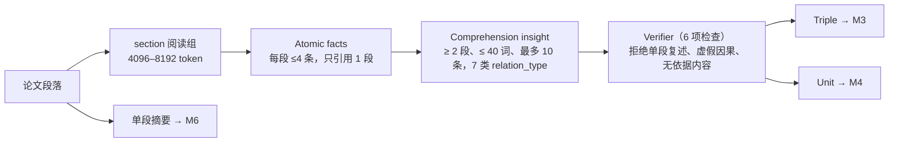

# 03 · QASPER（科研论文问答）— 阶段 D

> 时间：2026-11-10 · 机器：devcloud · 状态：**完成**（100 篇、372 题的冻结样本）
> 原始报告：
> - [QASPER_READTIME_FULL_REPORT.md](../../outputs/qasper_readtime/QASPER_READTIME_FULL_REPORT.md)（中文完整版）
> - [FINAL_REPORT.md](../../outputs/qasper_readtime/FINAL_REPORT.md)
> - [INDEX.md](../../outputs/qasper_readtime/INDEX.md)（产物索引）
> - [主报告 §8](../../docs/RSI_GraphRAG_FULL_METHOD_AND_EXPERIMENTS.md)

**一句话结论**：
- 在这个数据集上图不如 dense（Any@5 .692 vs .740）。
- 理解三元组 M3 是中性偏正（All@5 +1.1pp，CI 跨 0）。
- 理解 unit 只覆盖了 58% 的题，等权 RRF 在没覆盖到的题上把正确证据挤掉了：整体 −14.4pp。
- Reader 的上限很低：Oracle 只有 .487。
- **方法（覆盖和融合）与数据集（池小、单证据题已饱和）两方面都有问题。**

---

## 1. 数据集

### 1.1 为什么做 QASPER

LoCoMo 单段对话只有 19–32 个 session，R@20 约 .986，差 1 题就差 1pp，很难看出召回差异。QASPER 每篇论文有 40–70 段，36.8% 的题需要多段证据，19% 跨章节，理论上更能体现跨段理解。

### 1.2 规模（QASPER v0.3 validation）

| 指标 | 值 |
|---|---|
| papers / questions | 281 / 1,005（answerable 945，unanswerable 60） |
| 有映射 gold 的 answerable 题 | 888 |
| 每篇段落数 | 均值 46.95，P10 22，**P50 43**，P90 70，最大 281 |
| 每篇 token | 均值 4,681，P90 6,636 |
| **每题 gold 段落（每个标注者）** | **均值 1.75，P50 1，P90 3，最大 19** |
| 单段 / 多段 gold | 63.2% / 36.8% |
| 跨章节 | 19.0% |
| 只有图表证据 | 3.5% |
| top-5 占池比例 | 14.0% |

**冻结样本**：
- 抽样：`sha1(f"{seed}:{paper_id}")` 排序后取前 100 篇（seed 20261110），规则在评测前写入。
- 规模：100 篇 / **372 题**。其中 **333 题**可答且有文本证据，141 题多证据，56 题跨章节。

**有金标准吗**：有。每个标注者各自给出 evidence 段落。
- 映射级联：exact → concat → substring → fuzzy（Jaccard ≥ .85）。文本证据映射率 **100%**。
- `FLOAT SELECTED`（图表证据）不计入文本检索指标，但保留在 QA 里。
- 多标注者处理：先在每个标注者的证据集上分别算指标再平均，不要求同时召回所有标注者的并集。

### 1.3 一道题长什么样

```text
paper 1503.00841 (GE-FL robustness)          Q: "What background knowledge do they leverage?"
answer: "labeled features"                    gold: s01::p000, s06::p000, s06::p002   ← 3 段、跨 2 个章节
passage id: {paper}::s{section}::p{paragraph}   检索严格限制在所属论文内
```

### 1.4 别的工作做到多高

| 方法 | Answer F1 | Evidence F1 | 设置 |
|---|---:|---:|---|
| LED-base（原论文，test） | 33.6 | 29.9 | 全文微调 |
| LED-large（evidence） | — | 39.4 | — |
| Human lower bound | 60.9 | 71.6 | — |
| **我们 Dense / Full paper / Oracle（dev 样本）** | **46.4 / 47.6 / 48.7** | 11.9 / 7.3 / 95.5 | HY4 zero-shot，4096 token |

> 我们的 Evidence F1 是按 Reader 输出的段落算的，4096 token 的上下文会拉低 precision，和 LED 的口径不同。**检索质量请以 Any/All@k 为准。**

---

## 2. 实验方法

### 2.1 方法矩阵（每篇论文独立建图，检索单元始终是原始段落）

| 方法 | 图谱 / 检索结构 | 实现要点 |
|---|---|---|
| M0 | BM25 / Dense / Hybrid | BM25 k1=1.5, b=0.75；Dense 用 NV-Embed-v2；Hybrid 是等权 RRF（k=60） |
| M1 | HippoRAG2 G_raw | 官方 OpenIE，一个段落一个 chunk；`retrieval_top_k=50, linking_top_k=5` |
| M2 | G_raw + atomic facts | 逐段原子事实注入来源段落后重建 |
| **M3** | M2 + comprehension triples | 同一批 verified insight 的三元组表示 |
| **M4** | M2 + comprehension units（独立索引） | unit 单独 embedding，回溯到来源段落后与 M2 做等权 RRF |
| M5 | M3 + units | 双路 RRF |
| M4/M5 gated | 敏感性分析 | 只用 top-3 unit，unit 路权重 0.5 |
| M6 | M2 + 单段摘要 | 每段一句摘要；另做一个与 unit 数量相同的 matched 对照 |

> **知识量固定，只变表示**：M3、M4、M5 共享同一批 733 条 verified insight。

### 2.2 怎么做"理解"



**Prompt 约束**（代码：`src/qasper/prompts.py`）：
- Atomic facts：数字、单位和数据集名原样照抄；必须且只能引用 1 个 passage id；禁止推断。
- Insight：
  - `source_passage_ids` 至少 2 个，并引用 supporting fact id。
  - `derivation ∈ {Composed, Inferred}`；禁止把共现写成因果。
  - relation_type 共 7 类：claim_evidence、method_result、problem_solution、setting_outcome、combined_fact、assumption_limitation、entity_resolution。
- Verifier：
  - `keep=False`，或者 `causality_error=True`，都会被拒绝。
  - 解析失败时视为保留（fail-open）→ 这是后来在 DetectiveQA 里修正的问题之一。

---

## 3. 各模块结果

### 3.1 Read-time 生成质量

| 指标 | 值 |
|---|---|
| reading groups | 147 |
| atomic facts | 10,539 |
| candidate insights → verified units | 1,313 → **733**（保留率 55.8%） |
| 每篇 unit 数 | **7.3** |
| unit 长度 | 均值 24.6 词 |
| 来源跨 section 的比例 | **71.2%** |
| 来源段落距离 | 均值 9.9，P90 25 |
| verifier 拒绝原因 | 单段复述 207 / 无依据因果 143 / 不被支持 85 / 其他 145 |
| read-time token | prompt 2.88M / completion 1.62M |

### 3.2 检索（333 题）

| 方法 | Any@1 | Any@5 | All@5 | Recall@5 | MRR | Cov@4096 |
|---|---:|---:|---:|---:|---:|---:|
| M0 BM25 | .204 | .521 | .378 | .435 | .341 | .716 |
| **M0 Dense** | **.363** | **.740** | **.593** | **.658** | **.530** | **.889** |
| M0 Hybrid | .312 | .680 | .517 | .582 | .476 | .841 |
| M1 G_raw | .281 | .692 | .544 | .606 | .461 | .883 |
| M2 +Atomic | .300 | .697 | .545 | .608 | .477 | .884 |
| **M3 +Triples** | .321 | .707 | .556 | .620 | .493 | .886 |
| M4 +Units | .210 | .545 | .401 | .461 | .375 | .842 |
| M5 Triples+Units | .216 | .535 | .395 | .454 | .375 | .836 |
| M4 gated | .221 | .565 | .411 | .475 | .389 | .884 |
| M6 +Summaries | .359 | .709 | .575 | .635 | .521 | .884 |
| M6 matched count | .186 | .518 | .360 | .425 | .337 | .853 |

**配对差值（95% bootstrap CI）**

| 对比 | ΔAll@5 | CI |
|---|---:|---|
| M3 vs M2 | **+1.1pp** | [−0.2, +2.4] → 中性偏正 |
| M4 vs M2 | −14.4pp | [−19.7, −9.0] → 显著负迁移 |
| M5 vs M3 | −16.1pp | [−21.3, −10.7] |
| M6 matched vs M2 | −18.5pp | [−23.3, −13.5] |

### 3.3 子集与机制（本阶段最关键的证据）

| 子集 | n | M2 All@5 | M3 All@5 | M4 All@5 |
|---|---:|---:|---:|---:|
| 单段 gold | 219 | .674 | .689 | .530 |
| 多证据 | 141 | .358 | .362 | .216 |
| 跨章节 | 56 | .312 | .312 | .161 |
| **unit 覆盖 gold** | 193 | .567 | .585 | **.627** ↑ |
| **unit 未覆盖 gold** | 140 | .514 | — | **.089** ↓↓ |

- **覆盖是主瓶颈**：只有 193/333 = 58% 的题至少被一个 unit 的来源段落触及 gold。
- **排序不是瓶颈**：733 个 unit 里有 229 个至少一次触及 gold，其中只有 21 个从没进过 top-5。
- **位移是第二瓶颈**：等权 RRF 在没覆盖到的题上，也会把 unit 来源段落塞进 top-5。
- **RRF 权重扫描**：unit 权重只有 0.1 时 Any@5 .691，已经低于 graph-only 的 .697；权重到 0.2 就崩了。固定权重救不回来，必须做相关性门控。
- **M6 的启示**：给每段都做摘要（4,561 条）时 All@5 是 .575；摘要数量压到和 unit 一样（733 条）只有 .360。说明收益来自覆盖，而不是"理解"。

### 3.4 Reader QA（372 题，4096-token 预算）

| 方法 | Answer F1 | EM | F1 multi | F1 cross | gold 全在上下文 |
|---|---:|---:|---:|---:|---:|
| M0 Dense | .464 | .210 | .428 | .389 | .763 |
| M1 G_raw | .455 | .202 | .431 | .390 | .758 |
| M3 +Triples | .454 | .204 | .422 | .400 | .763 |
| M4 +Units | .435 | .191 | .402 | .369 | .707 |
| M5 | .443 | .194 | .411 | .394 | .702 |
| **Full paper** | .476 | .220 | .455 | .434 | .890 |
| **Oracle gold** | **.487** | .242 | .455 | .447 | .895 |

- 把 unit 文本直接给 Reader（mode B）也没有收益（Δ −0.000）。
- 只有图表证据的题，所有方法都是 .369；不可回答的题，所有方法都是 .909。
- **Oracle 比 Dense 只高 2.3pp：检索层的差异几乎没有空间传导到答案。**

---

## 4. Case 分析

> 完整列表：[cases.md](../../outputs/qasper_readtime/cases.md)。逐题链路：`mechanism/question_chains_sample100.jsonl`。逐 unit 使用轨迹：`mechanism/unit_usage_sample100.jsonl`。

| 类型 | qid / 问题 | 变化 | 机制 |
|---|---|---|---|
| ✅ unit 覆盖 gold | `50be4a73…` "What background knowledge do they leverage?"（gold s01::p000, s06::p000, s06::p002） | All@5：M2 .0 → M4 .5 | unit `1503.00841::u000` 把跨 4 段的组合知识压成一句，并回溯到 s01::p000 |
| ✅ 同上 | `02428a8f…` "How do they define robustness of a model?" | M2 .0 → M4 .5 | 命中 u000 与 u002 |
| ❌ unit 挤掉证据 | `6bf5620f…` "What baseline model is used?"（gold 只有 s06::p000） | M2 1.0 → M4 0.0 | top-5 全是该论文其他 unit 的来源段落，单段 gold 被挤出 |
| ❌ 同上 | `747b847d…` "Which parallel corpora are used?" | M2 1.0 → M4 0.0 | 同上 |
| 🛡 verifier 拒绝 | "…only 8% of English arguments … are aligned"（声称这些比例 limit 了模型） | 拒绝 | 原文没有支持这个因果 |
| 🛡 verifier 拒绝 | "GE-FL is the baseline that leverages labeled features…" | 拒绝 | 只是 s01:p000 的复述 |

---

## 5. 已完成 / 未完成

| 项 | 状态 |
|---|---|
| 数据解析、证据映射、冻结 100 篇样本 | ✅ |
| M0–M6 检索、子集分析、RRF 权重扫描、逐 unit 追踪 | ✅ |
| Reader QA（含 Full paper / Oracle / Top-k 敏感性） | ✅ |
| semantic 分组对照 | △ 只做了 20 篇 / 72 题的检索；section 分组更好，semantic 分组未做 QA |
| 全部 281 篇 | ⛔ 未做（只是机械工作） |
| 覆盖扩张（按 section 生成 unit）/ 相关性门控融合 / unit→passage reranker | ⛔ 未做（报告建议的下一步） |
| 更强的 Reader | ⛔ 未做（本项目限定只用 HY4） |

## 6. 问题归因

| 现象 | 归因 |
|---|---|
| Dense Any@5 已有 .740，单证据题接近饱和 | **数据集**：池仍然小（P50 43），63% 的题只有单段证据 |
| 论文内段落很少需要"事件式"的跨段理解 | **数据集与 claim 不匹配**：关系多为 method→result 这类结构性关系，而不是状态变化 |
| 图 < dense | **方法 / 数据集**：科研文本的实体（方法名、数据集名）在整篇论文里到处出现，PPR 区分度弱 |
| unit 只覆盖 58% + RRF 位移 | **方法**：每篇 7.3 个 unit 太稀疏；等权融合缺少门控 |
| Oracle 只有 .487 | **方法（Reader）**：检索差异传不到答案 |

## 7. 复现

逐步命令见 [README_PIPELINE.md](../../outputs/qasper_readtime/README_PIPELINE.md)；代码在 `src/qasper/`、`scripts/qasper/`；配置在 [experiment_config.md](../../outputs/qasper_readtime/experiment_config.md)。

## 8. 文件索引

| 文件 | 内容 |
|---|---|
| [dataset_audit.md](../../outputs/qasper_readtime/dataset_audit.md) · `dataset/` | 解析、证据映射、池统计、冻结样本（每篇 `paragraphs.jsonl` / `qa.jsonl`） |
| [baseline_retrieval.md](../../outputs/qasper_readtime/baseline_retrieval.md) | BM25 / Dense / Hybrid |
| [comprehension_quality.md](../../outputs/qasper_readtime/comprehension_quality.md) · `comprehension/section/{paper}/` | 生成量、保留率、关系类型；每篇的 atomic facts / insights / units / summaries |
| [retrieval_comparison.csv](../../outputs/qasper_readtime/retrieval_comparison.csv) · `retrieval/comparison_sample100.jsonl` | M0–M6 指标与逐题排序 |
| [qa_comparison.csv](../../outputs/qasper_readtime/qa_comparison.csv) · `qa/predictions_sample100.jsonl` | QA 指标与逐题答案 |
| `mechanism/` · [source_provenance.jsonl](../../outputs/qasper_readtime/source_provenance.jsonl) | unit 使用轨迹、逐题链路、unit 来源 |
| [cases.md](../../outputs/qasper_readtime/cases.md) | 正例 / 负例 / 无影响 / 过度推断 |
