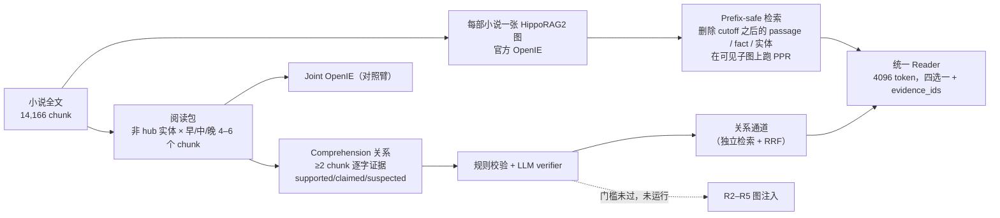

# 04 · DetectiveQA（侦探小说）— 当前主线

> 时间：2026-11-11 → 11-12 · 机器：devcloud · 状态：**Pilot + Round 2 完成；图变体 R2–R5 与 Question-Time 闭环未运行**
> 原始报告：[PILOT_REPORT.md](../../outputs/detectiveqa/PILOT_REPORT.md)（Round 1，中文）· [ROUND2_REPORT.md](../../outputs/detectiveqa/round2/ROUND2_REPORT.md)（Round 2，英文）· [RUN_LOG.md](../../outputs/detectiveqa/round2/RUN_LOG.md)

**一句话结论**：
- 图检索没有通过预注册门槛：R@10 只多 0.7pp，CI 跨 0；MRR 低 4.8pp，p=.012。
- 只读 cutoff 前最近 4096 token 的 `recent` 基线就有 .805，等于 oracle。
- gold 标注本身不可靠：30/41 题在 cutoff 前已剧透，16/41 题 gold 不充分。
- **主要是数据集切分和标注问题，其次是关系层 precision 不够。** 下一步先做 anti-reveal 子集。

---

## 1. 数据集

### 1.1 为什么换到 DetectiveQA

| 需求 | MuSiQue | LoCoMo | QASPER | **DetectiveQA** |
|---|---|---|---|---|
| 连续世界、远距离线索 | ✗ | △（对话短） | △（段间关系弱） | ✓ 同一部小说内线索跨度中位数 645 段 |
| 有 gold 证据 | ✓ | ✓ | ✓ | ✓ 每题有 clue 段落号 |
| 能限制"只读到问题位置" | ✗ | ✗ | ✗ | ✓ `answer_position`，可做增量阅读 |
| 同一故事多题 → Question-Time 记忆 | ✗ | ✓ | △ | ✓ 112/154 道人工题前面有同小说练习题 |
| 检索池足够大 | ✓ | ✗（19–32） | △（P50 43） | ✓ 每题可见 chunk 中位数 170 |

### 1.2 规模（英文版，HF `Phospheneser/DetectiveQA`，Apache-2.0）

| 项目 | 数值 |
|---|---:|
| 小说 | 62 |
| 题目（四选一） | 600 = human_anno 154（23 部小说）+ AIsup_anno 446（62 部） |
| chunk（目标 200 词、最多 320 词；在每个 cutoff 处强制断开） | 14,166 |
| 每题 clue 段落 | 中位数 5 |
| clue 跨度 | 中位数 645 段，P90 2,220 段 |
| cutoff 前可见文本 | 中位数约 49.8k 英文词 |
| **每题可见 chunk** | 中位数 **170** |
| **每题 gold chunk（应召回范围）** | 中位数 **4**（pilot 41 题：1–15 个） |
| 晚于 cutoff 的 clue | 21 / 3,803，已删除 |

**冻结划分**（seed 20261111，`src/detectiveqa/data.py`）：

| split | 用途 | 规模 |
|---|---|---:|
| `eval_human` | 最终评测，永远不更新记忆 | 154 |
| `within_practice` | 与人工题同小说的 AI 题，用于测同一故事内的记忆迁移 | 161 |
| `cross_practice` | AI-only 小说，用于学习跨小说技能 | 208 / 29 部 |
| `cross_dev` | AI-only 小说，用于技能接受和负迁移检查 | 77 / 10 部 |

**Pilot 子集**：6 部小说（27, 79, 117, 118, 121, 124），**41 道 human 题**（去掉 117 的 5 道近重复题后为 36 道）。

### 1.3 一道题长什么样

```json
{"qid": "human_anno:117:00", "novel_id": "117",
 "question": "Aveline instructed Polo not to tell anyone when she left, which implies that:",
 "options": {"A": "She is going to a rendezvous.", "B": "She is going to swim at the beach.",
             "C": "She is going to buy clothes.", "D": "She enjoys being alone."},
 "answer": "A", "cutoff": 480,
 "clue_paragraphs": [92, 94, 98, 101, 103, 107, 226, 229, 246, 441, 478]}
```

这道题的线索从第 92 段一直分布到第 478 段（Elena 与 Redfern 的关系），需要跨越整个前半部才能推出答案。这正是我们想要的"跨文档理解"形态。

### 1.4 已知数据问题（审计中发现）

| 问题 | 现象 | 处理 |
|---|---|---|
| qid 冲突 | `human_anno/149.json` 是小说 117 的第二份英文标注，与 117 的 5 道题 qid 冲突，被 loader 静默丢掉 | 已修：文件名加判别符（`human_anno:117:149:00`），并报告去重 36 题的敏感性 |
| 译名不一致 | 41 题中 17 题至少有一个名字在原文里找不到，例如 Kristen / Christen / Christine | 记录；不是检索失败的主因，0/7 个 dense miss 与此有关 |
| 选项噪声 | 6 个选项带 `200:` 前缀 | 只清理明确的 `200:` 前缀 |
| 模型记忆 | Christie / Ellery Queen 等名著可能被模型记住 | 必报 `options_only_memory` 基线（.463） |
| **剧透** | cutoff 往往很晚（15/41 ≥ 90%），最近的文本里常有侦探的解释 | Round 2 发现：**30/41 题在 cutoff 前已明确揭晓** |
| **gold 不充分** | clue 更像"标注者认为相关的段落"，不是最小充分证据 | Round 2 LLM judge：16/41 不充分，23/41 有歧义或可疑 |

### 1.5 别的工作做到多高

| 方法 | DetectiveQA Acc | 设置 |
|---|---:|---|
| ComoRAG（AAAI'26） | 68.2 | GPT-4o-mini + BGE-M3，全文检索、迭代探查 |
| RAPTOR + IRCoT | 64.8 | 同上 |
| HippoRAGv2 + IRCoT | 62.5 | 同上 |
| **我们 pilot：q_graph / recent / oracle** | **68.3 / 80.5 / 80.5** | HY4，41 道 human 题，prefix-safe |

> 口径不同（模型、题目子集、是否做 prefix 截断、是否给选项），只作数量级参考。更多数字见 [docs/REFERENCE_NUMBERS.md](../../docs/REFERENCE_NUMBERS.md)。

---

## 2. 实验方法

### 2.1 框架



### 2.2 关键设计

| 设计 | 细节 | 代码 |
|---|---|---|
| 切块 | 目标 200 词、最多 320 词；在每个问题的 cutoff 处强制断开，保证 gold 不会被整块截断 | `src/detectiveqa/data.py::build_chunks` |
| 一部小说一张图 | 先用全文建一次图；每道题检索时删掉未来的 passage、fact 和只在未来出现的实体，在可见子图上跑 PPR，未来文本不能当桥 | `src/detectiveqa/graph.py::PrefixGraphRetriever` |
| 防泄漏检查 | 6 项：chunk `end_pid < cutoff`、fact 有可见来源、子图无未来节点、无未来实体、边权只用可见来源重算、重复检索稳定。**41 题全部 0 失败** | `scripts/detectiveqa/check_prefix_safety.py` |
| 查询方式 | Round 1 主表用 `qo`（问题+选项）；Round 2 改为 **q-only 为主、qo 只做诊断**，对齐近期论文 | `run_round2_retrieval.py` |
| LLM fact reranker | 默认关闭（LoCoMo 上关闭后新关系更容易进 PPR）；Round 1 单独做了开启对照 | `--llm-rerank` |
| Reader | 同一 prompt、4096 估算 token（cl100k）、按故事顺序渲染、输出 `{answer, evidence_ids}` | `src/detectiveqa/reader.py` |
| 统计 | Round 2 用**按小说聚类的 bootstrap（5000 次）+ McNemar**，两个选项顺序 seed | `scripts/detectiveqa/analyze_round2.py` |

### 2.3 Reader 上下文条件（"理解"之外的必要对照）

| 条件 | 给 Reader 的内容 | 作用 |
|---|---|---|
| `options_only` | 只有题目和选项，system prompt 禁止使用书中记忆 | 选项偏差 |
| `options_only_memory` | 只有题目和选项，**允许**使用先验知识 | 参数记忆上界 |
| `q_dense` / `q_graph` / `q_rrf` | 按检索排序装满 4096 token | 可部署的方法 |
| `recent`（Round 1 叫 `long_prefix`） | cutoff 前最近 4096 token | 局部性基线 |
| `nonrecent_q_dense` | 删掉最近 4096 token 后再做 q_dense | 去掉局部性 |
| `recent_plus_q_dense` | 一半预算给 recent，一半给 q_dense | 组合 |
| `oracle` | 只给 gold clue 所在的可见 chunk | 诊断上限（实际并不是严格上限） |

### 2.4 怎么做"理解"（Read-Time Comprehension）

1. **阅读包**（只用 OpenIE 实体统计，不看题目、选项和 clue）：
   - 选出在小说中反复出现、但不是高频泛化词的实体。
   - 对每个实体，在故事的早、中、晚期各取若干个 chunk，组成 4–6 个 chunk 的包。
   - 同一个包同时喂给 Joint OpenIE 对照臂和 Comprehension，两者的差异只来自抽取目标。
2. **关系约束**：
   - 至少引用 2 个不同 chunk，每个 chunk 都要有逐字 quote。
   - 不能是普通 fact 的改写。
   - 关系**挂到最晚的证据块**上（`available_at`），保证增量阅读时不会提前泄漏。
   - 用 `supported / claimed / suspected` 区分事实、证词和怀疑。
   - 7 类关系：alias_or_identity、alibi_or_opportunity、motive_or_interest、method_or_capability、contradiction_or_deception、timeline_or_causal、state_change。
3. **两级过滤**：
   - 规则层：`needs_two_chunks` / `quote_not_found` / `too_long` / `generic_predicate` / `duplicate_fact`。
   - LLM verifier：输出 `keep / fixed_status / semantic_support / cross_chunk_necessary / specificity`。
4. **进入检索的两条路**：
   - 关系通道：关系文本单独建索引，与 dense/graph 做 RRF。
   - 注入 HippoRAG 图（R2–R5）：本轮因门槛未过，**未运行**。

| 版本 | 包数 | 原始候选 | 规则通过 | verifier 保留 | 主要变化 |
|---|---:|---:|---:|---:|---|
| v1 | — | — | — | — | Joint 臂在 6-chunk 包上生成 150+ fact，输出被截断，结果为空 |
| v2（Round 1 smoke） | 30 | 280 | 251 | **39** | Joint 臂最多 40 条 fact；verifier 偏保守 |
| **v3（Round 2）** | 120 | 1,435 | 1,122 | **601** | 使用 `fixed_status`；谓词必须具体；verifier 不再重复检查 quote |

### 2.5 预注册门槛（Round 2）

| 路线 | 通过条件 | 结果 |
|---|---|---|
| 图路线 | q_graph 或 q_rrf 在 R@10 或 All@20 上胜过 q_dense，且聚类 CI 下界 > 0 | ❌ |
| 关系路线 | 关系通道在 ≥25% 的题上触及 gold，**并且** q_rrf R@10 提升 ≥3pp（或在早/中期题上有明确 case 胜出） | 覆盖 ✅ 41.5%；R@10 ❌ −10.6pp |
| 图注入 | kept ≥100 条，**并且**人工 kept precision ≥75% | 数量 ✅ 601；precision ❌ 66.7% |
| 扩大规模 | 收益出现在 late-cutoff 之外，并在 option seed 1 上复现 | ❌ |

---

## 3. 结果

### 3.1 建图（6 部小说）

| novel | chunk | 节点 | 抽取三元组 | 建图耗时 s |
|---|---:|---:|---:|---:|
| 27 | 316 | 5,575 | 9,035 | 1,321 |
| 79 | 262 | 4,698 | 6,206 | 4,208 |
| 117 | 187 | 3,133 | 4,951 | 3,730 |
| 118 | 204 | 3,200 | 5,167 | 3,960 |
| 121 | 182 | 3,260 | 4,918 | 3,653 |
| 124 | 230 | 3,663 | 5,349 | 4,140 |
| **合计** | **1,381** | **23,529** | **35,626** | 21,012 |

- 总 token：2.93M（prompt 2.09M，completion 0.83M）。
- 3 个 chunk 的 OpenIE 失败，用空结果容错，没有当作成功。

### 3.2 检索（41 题；MRR 中未召回记 0）

**Round 1（q 与 qo）**

| 条件 | Any@5 | R@10 | R@20 | All@20 | MRR |
|---|---:|---:|---:|---:|---:|
| q_dense | .610 | .418 | .515 | .220 | .543 |
| q_graph | .658 | .425 | .538 | .244 | .496 |
| qo_dense | .707 | .436 | .527 | .244 | .599 |
| qo_graph | .658 | .407 | .537 | .244 | .484 |

**Round 2（q-only 为主，按小说聚类的配对检验）**

| 条件 | R@10 | R@20 | All@20 | All@50 | MRR | vs q_dense |
|---|---:|---:|---:|---:|---:|---|
| q_dense | .418 | .515 | .220 | .463 | **.544** | — |
| q_bm25（可见 chunk 上重建 IDF） | .287 | .426 | .122 | .390 | .455 | R@10 −13.1pp |
| q_graph_f5 | .425 | .538 | .244 | .463 | .497 | R@10 +0.7 [−3.5,+4.3]；MRR −4.8，**p=.012**（4 胜 16 负） |
| q_graph_f10 | .420 | .540 | **.268** | .463 | .462 | MRR −8.2，p=.0015 |
| q_graph_f20 | .415 | .534 | .244 | .463 | .452 | MRR −9.3，p=.009 |
| q_graph_f5_nosyn | .412 | .534 | .220 | .463 | .501 | 同义边几乎没贡献 |
| q_rrf(dense+graph) | **.429** | .523 | .220 | .463 | .516 | R@10 +1.1，CI 跨 0 |
| q_rrf_all | .402 | .508 | .220 | .488 | .541 | — |

**按 cutoff 位置分桶（q-only，R@10 / All@20）**

| 分桶 | n | q_dense | q_graph_f5 | 结论 |
|---|---:|---|---|---|
| early < 70% | 18 | .578 / .389 | .588 / .444 | 图略好 |
| middle 70–90% | 8 | .396 / .250 | .458 / .250 | 图略好 |
| late ≥ 90% | 15 | .239 / **.000** | .212 / **.000** | 所有方法 All@20 都是 0 |

**Fact 种子机制**：
- q_graph_f5 在 27/41 题上至少有一条触及 gold 的 fact（平均每题 1.32/5 条）；f10 是 30 题，f20 是 33 题。
- 种子越多，覆盖越高，但 MRR 越低：.497 → .462 → .452。
- 开启官方 LLM reranker（Round 1，qo）：每题约多 4.4s，没有稳定收益。

### 3.3 Reader（41 题，两个选项顺序 seed）

| 条件 | seed0 | seed1 | gold-any | gold-all | 两 seed 一致率 |
|---|---:|---:|---:|---:|---:|
| options_only | .293 | .439 | 0 | 0 | .488 |
| options_only_memory | .463 | .439 | 0 | 0 | .732 |
| q_dense | .658 | .585 | .756 | .122 | .902 |
| q_graph | .683 | .658 | .780 | .146 | .902 |
| q_rrf | .634 | .634 | .780 | .122 | .902 |
| qo_dense | .707 | .707 | .732 | .220 | .805 |
| **recent** | **.805** | **.805** | .512 | .122 | **.976** |
| nonrecent_q_dense | .439 | .390 | .585 | 0 | .951 |
| recent_plus_q_dense | .805 | .732 | .683 | .195 | .902 |
| oracle | .805 | .707 | 1.000 | .927 | .854 |

**关键配对检验**（按小说聚类）：

| 对比 | seed0 Δ | seed1 Δ |
|---|---|---|
| q_dense → q_graph | +2.4pp [0, +8.1]，p=1 | +7.3pp [+2.3, +13.9]，p=.375 |
| q_dense → recent | +14.6pp，p=.109 | **+22.0pp，p=.012** |
| recent → nonrecent | **−36.6pp，p=.0015** | **−41.5pp，p=.0005** |
| q_dense → oracle | +14.6pp，p=.146 | +12.2pp，p=.267 |

**recent 的优势不只出现在晚期题**：按 early / middle / late 分桶，recent 是 .833 / .75 / .80，nonrecent 是 .50 / .375 / .40。

**错误分解（seed0，答错的题按 gold 是否在上下文里分）**

| 条件 | gold 全在 | gold 部分在 | gold 不在 |
|---|---:|---:|---:|
| q_dense | 1 | 10 | 3 |
| q_graph | 2 | 8 | 3 |
| recent | 0 | 3 | 5 |
| oracle | **6** | 2 | 0 |
| nonrecent_q_dense | 0 | 12 | 11 |

> Round 1 曾得出"Reader 是瓶颈"（dense 的 12 个错误里有 9 个 gold 已到达）。Round 2 指出这个结论**说过头了**：Round 1 的"到达"只要求任意一个 gold chunk 在上下文里。按 gold-all 统计，dense 只有 12% 的题完整拿到了证据。

### 3.4 Read-Time v3：质量与使用

**漏斗**：120 个包 → 5,114 条 joint fact → 1,435 条 comprehension 候选 → 1,122 条通过规则 → **601 条 verifier 保留**。
- 规则拒绝：too_long 110、needs_two_chunks 180、quote_not_found 21、generic 1、duplicate 1。

**人工审计 60 条**（30 条 kept、20 条 verifier 拒绝、10 条规则拒绝，覆盖 6 部小说）

| 标签 | 数量 | 占比 |
|---|---:|---:|
| correct_cross_chunk | 26 | 43% |
| correct_but_fact_rewrite | 19 | 32% |
| insufficient_evidence | 10 | 17% |
| entity_alignment_error | 3 | 5% |
| too_generic | 2 | 3% |

- **kept 集真正跨块的比例：20/30 = 66.7%**。把"正确的事实改写"也算上是 80%，但那样就背离了"理解"的目标。
- 被误杀：verifier 拒绝的里有 3/20 是好关系；规则拒绝的里有 3/10 是好关系，大多被 `too_long` 误杀。
- 分类型 precision：
  - alias 11/17：准，但大多只是实体归一。
  - timeline 6/18、contradiction 3/9、motive 2/6、state_change 0/3：对推理最有用的这几类反而最差。

**关系通道与关系 QA**

| 条件 | R@10 | All@20 | MRR | QA（seed0） |
|---|---:|---:|---:|---:|
| q_dense | .418 | .220 | .544 | .658 |
| relation_chunks only | .137 | — | — | — |
| RRF(dense+graph+relation) | .312 | .195 | .352 | — |
| relations_q_dense（关系作 note 给 Reader） | — | — | — | .658（Δ 0） |
| relations_q_rrf | — | — | — | .658（vs q_rrf .634，+2.4pp，CI 跨 0） |

- 41.5% 的题有触及 gold 的 top 关系，覆盖门槛通过。
- 但等权 RRF 把好 chunk 挤了下去，与 QASPER 上 unit 的问题相同。

### 3.5 成本

| 阶段 | 调用 | token |
|---|---:|---:|
| 建图（6 部） | 2,762 | 2.93M |
| Round 2 read-time v3 | 350 | 1.94M |
| Round 2 Reader（10 条件 × 2 seed × 41） | 534 | 1.90M |
| 关系 QA + case judge | 137 | 0.65M |

---

## 4. Case 分析

> 完整 34 行 case 表：[round2_case_table.md](../../outputs/detectiveqa/round2/round2_case_table.md)。LLM judge 原始输出：[round2_case_judge.jsonl](../../outputs/detectiveqa/round2/round2_case_judge.jsonl)。Round 1 逐题 gold 排名：[PILOT_REPORT 附录 A](../../outputs/detectiveqa/PILOT_REPORT.md)。

**LLM case judge（41 题，题级标签，可多选）**

| 标签 | 题数 |
|---|---:|
| reveal_before_cutoff | 28（加上显式检查共 30） |
| gold_ambiguous_or_wrong | 23 |
| entity_alias_error | 22 |
| gold_incomplete | 12 |
| option_bias_or_memory | 9 |
| correct_by_shortcut / partial_evidence | 6 / 6 |
| correct_supported | 5 |

**代表 case**（Y/N 依次表示 dense / graph / rrf / recent / nonrecent / recent+dense / oracle / memory 是否答对）

| qid | 模式 | 正误 | 说明 |
|---|---|---|---|
| 27:00 | gold 不完整 | Y/Y/Y/Y/Y/Y/**N**/Y | gold 漏了决定性的"ordering caviar"句（说明 Andrew 曾经富有），所以只有 oracle 答错 |
| 27:06 "Who is the real killer?" | 题目区分不了方法 | 全对，包括 memory | 15 个 gold chunk 是标注者的推理链；graph top-1 直接写着 "The killer is Vilga Crocet" |
| 117:01 / 117:149:01 | 多个选项都对 | 检索都对，nonrecent 和 memory 错 | gold 选 A（恐高），但 B（手表）也是一条真实的谎言 |
| 118:06 | gold 不完整 + 局部性 | N/Y/N/Y/N/Y/**N**/N | recent 和 graph 对，oracle 反而错 |
| 124:05 | gold 可能错了 | 全错，只有 nonrecent 对 | 结尾证据指向 Mrs. Brand，gold 是 Mr. Brand |
| 124:00 | Reader 错 | dense 拿到了全部 gold 仍错 | 真正的 Reader 瓶颈 case |
| 79:04、27:04 | 局部性 + 剧透 | 只有 recent / recent+dense / oracle 对 | 检索漏了，答案就在 cutoff 附近 |
| 79:02 | recent 会误导 | dense / graph / oracle 对，recent 错 | 少数 recent 反而有害的 case |
| 121:00 | graph 胜 dense | N/Y/Y/Y/… | 但 recent 也对，不算图的独有胜利 |

dense 和 graph 意见不一致的 3 题（118:01、118:06、121:00）里，recent 都答对了。**所以没有一个 case 能算作"图独有的胜利"。**

**Read-time 关系实例**（人工审计，[readtime_v3_manual_audit.jsonl](../../outputs/detectiveqa/round2/readtime_v3_manual_audit.jsonl)）

| id | 关系 | 标签 |
|---|---|---|
| a00 | Clinton — was believed missing in → Van murder case and nationwide search | ✅ 跨块，但价值低 |
| a14（v2） | 尸体戴绿色纸帽，衣柜里却只有猩红和淡黄两顶 | ✅ 真实的物证矛盾 |
| a06（v2） | Hayama 手里的原钥匙 + 有人用 Ito 的钥匙从外面锁门 | ✅ 密室手法链 |
| a04 | Miss Lemon's sister — was said to be considering → a boat trip | ⚠️ 事实改写 |
| a01 | Medvedev's requiem — is linked to → Orthodox church… | ⚠️ 太泛 |
| a06（v3） | Clinton — was strong enough for → lifting a body | ❌ 证据不足 |
| a08 | Mrs. Redfern — afraid of → steep steps | ❌ 实体错配（梯子那句说的是 Linda） |

---

## 5. 已完成 / 未完成

| 项 | 状态 |
|---|---|
| 数据审计、切块、划分、qid 修复、单元测试 | ✅ |
| 6 部小说建图 + prefix-safe 检查（0/41 失败） | ✅ |
| Round 1：dense vs graph（q/qo/rerank）、6 个 Reader 条件、read-time v2 smoke + 30 条人工审计 | ✅ |
| Round 2：q-only 主表、fact top-k、同义边、RRF、BM25、recent/nonrecent、两个 seed、聚类统计、LLM case judge、34 个 case | ✅ |
| Round 2：read-time v3 + 60 条人工审计 + 关系通道 + 关系 QA | ✅ |
| R2–R5 图变体（joint / validated / kept / count-matched） | ⛔ 未运行（门槛未过） |
| Question-Time 闭环（Comprehension Memory / Retrieval Skill / Reasoning Skill） | ⛔ 未运行（代码和泄漏 gate 已写在 `src/detectiveqa/evolution.py`） |
| 扩展到 23 部 human 小说 / 154 题 | ⛔ 未运行（估计建图约 11M token） |
| anti-reveal 子集 + gold 重审 | ⏳ 下一步 |
| AI 标注题（446 道）的使用 | ⏳ 只做了划分 |

---

## 6. 问题归因：数据集还是方法？

| 现象 | 归因 | 依据 |
|---|---|---|
| recent = oracle = .805，nonrecent 掉到 .44 | **数据集（局部性 / 剧透）** | 30/41 题在 cutoff 前已揭晓；三个分桶里都成立 |
| oracle 不是上界，甚至低于 recent | **数据集（gold 质量）** | 16/41 不充分，23/41 有歧义；27:00、118:06、124:05 |
| 不看原文也有 .463 | 数据集 / 模型（记忆） | 40/41 个 memory 条件被 judge 标为 option bias 或记忆 |
| 41 题、6 部小说，1 题 = 2.4pp | 实验规模 | 两个 seed 的 Reader 差异就有好几个点 |
| 图的 MRR 低于 dense | **方法** | fact 种子越多排序越漂；同义边几乎没贡献 |
| 关系 precision 只有 66.7%；最有用的类型最不准 | **方法** | timeline 6/18、motive 2/6 |
| 关系 RRF 降低 R@10（.418 → .312） | **方法（融合）** | 和 QASPER unit 的现象一样，需要相关性门控而不是等权 RRF |
| gold-all 只有 12%（dense） | 方法 + 数据集 | gold 散在 5–15 个 chunk 里，4096 token 装不下 |

**结论：** 当前 split 上的瓶颈首先是数据集（局部性、剧透、标注）。图和关系方法也有自身问题（排序、precision、融合）。在数据集问题修好之前，图方法的信号测不出来。

---

## 7. 下一步

1. **构建 anti-reveal 子集**：只保留决定性证据不在最近 4096 token 里的题，并重审 gold，优先 124:05、79:03、27:01、79:01。在这个子集上重跑 Stage A/B。
2. **`recent` 和 `options_only_memory` 进所有表**，收益要相对这两条基线报告。
3. **修关系层**：
   - 过滤只有 alias 的关系和事实改写；放宽 `too_long` 规则。
   - 重点生成 timeline / motive / contradiction 类型，并显式要求跨块必要性。
   - 重新审计 60 条，要求 kept precision ≥75%。
4. 上面都通过后，**在 anti-reveal 子集上测 R3**：要求 R@10 或 All@20 的 CI 下界 > 0，并且在非晚期题上 Reader 也有收益。
5. 最后才启动 Question-Time 闭环。

---

## 8. 复现

```bash
cd /group/40150/licochen/Memory/RSI_GraphRAG && source .venv/bin/activate
export TIKTOKEN_CACHE_DIR=$PWD/cache/tiktoken HF_HUB_OFFLINE=1 HY4_RATE_FILE=detectiveqa HY4_GLOBAL_QPS=1
python -m unittest discover -s tests -p 'test_detectiveqa*.py' -v
python scripts/detectiveqa/prepare_data.py
python scripts/detectiveqa/build_raw_graphs.py --split pilot --novels 27          # 其余小说可以加 --out 并行跑
python scripts/detectiveqa/check_prefix_safety.py --split eval_human --novels 27,79,117,118,121,124 --k 20 --out prefix_safety
# Round 1
python scripts/detectiveqa/run_retrieval.py --split eval_human --novels 27,79,117,118,121,124 --query-mode both --top-k 20 --out retrieval_eval_human_raw_both
python scripts/detectiveqa/run_reader.py --split eval_human --novels 27,79,117,118,121,124 \
  --conditions options_only,options_only_memory,dense,graph,oracle,long_prefix --out reader_pilot
python scripts/detectiveqa/run_readtime_smoke.py --novels 27,79,117,118,121,124
# Round 2
python scripts/detectiveqa/run_round2_retrieval.py --modes q,qo --top-k 50 --fact-top-k 5,10,20 --out round2_retrieval
python scripts/detectiveqa/run_round2_reader.py --retrieval round2/round2_retrieval.jsonl \
  --conditions options_only,options_only_memory,q_dense,q_graph,q_rrf,qo_dense,recent,nonrecent_q_dense,recent_plus_q_dense,oracle \
  --option-seeds 0,1 --out round2/round2_reader
python scripts/detectiveqa/run_readtime_v3.py --packets-per-novel 20 --chunks-per-packet 5 --max-words 1500 --out round2/readtime_v3
python scripts/detectiveqa/run_relation_channel.py && python scripts/detectiveqa/judge_round2_cases.py && python scripts/detectiveqa/make_round2_report.py
```

## 9. 文件索引

| 文件 | 内容 |
|---|---|
| [`outputs/detectiveqa/data_audit.json`](../../outputs/detectiveqa/data_audit.json) · [`splits.json`](../../outputs/detectiveqa/splits.json) · [`questions.jsonl`](../../outputs/detectiveqa/questions.jsonl) | 数据审计、划分、全部 600 题 |
| [`prefix_safety.summary.json`](../../outputs/detectiveqa/prefix_safety.summary.json) | 防泄漏检查 |
| [`raw_graph_build_stats.json`](../../outputs/detectiveqa/raw_graph_build_stats.json) | 建图统计 |
| [`retrieval_summary.md`](../../outputs/detectiveqa/retrieval_summary.md) · [`retrieval_failure_cases.json`](../../outputs/detectiveqa/retrieval_failure_cases.json) | Round 1 检索 |
| [`reader_pilot.jsonl`](../../outputs/detectiveqa/reader_pilot.jsonl) · [`reader_analysis.json`](../../outputs/detectiveqa/reader_analysis.json) | Round 1 Reader 逐题结果 |
| [`readtime_smoke_summary.json`](../../outputs/detectiveqa/readtime_smoke_summary.json) · [`readtime_manual_audit.jsonl`](../../outputs/detectiveqa/readtime_manual_audit.jsonl) | Read-time v2 |
| [`round2/round2_retrieval.jsonl`](../../outputs/detectiveqa/round2/round2_retrieval.jsonl) · [`round2_reader.jsonl`](../../outputs/detectiveqa/round2/round2_reader.jsonl) · [`round2_reader_tables.md`](../../outputs/detectiveqa/round2/round2_reader_tables.md) | Round 2 逐题结果 |
| [`round2/readtime_v3.jsonl`](../../outputs/detectiveqa/round2/readtime_v3.jsonl) · [`readtime_v3_manual_audit.jsonl`](../../outputs/detectiveqa/round2/readtime_v3_manual_audit.jsonl) · [`relation_channel_*.json`](../../outputs/detectiveqa/round2/) | Read-time v3 |
| [`round2/stageA_cases.md`](../../outputs/detectiveqa/round2/stageA_cases.md) · [`round2_case_table.md`](../../outputs/detectiveqa/round2/round2_case_table.md) | Case |
| [`docs/plans/DETECTIVEQA_RESEARCH_PLAN.md`](../../docs/plans/DETECTIVEQA_RESEARCH_PLAN.md) · [`DETECTIVEQA_ROUND2_PLAN.md`](../../docs/plans/DETECTIVEQA_ROUND2_PLAN.md) | 实验计划 |
| `src/detectiveqa/` · `scripts/detectiveqa/` · `tests/test_detectiveqa*.py` | 代码 |
